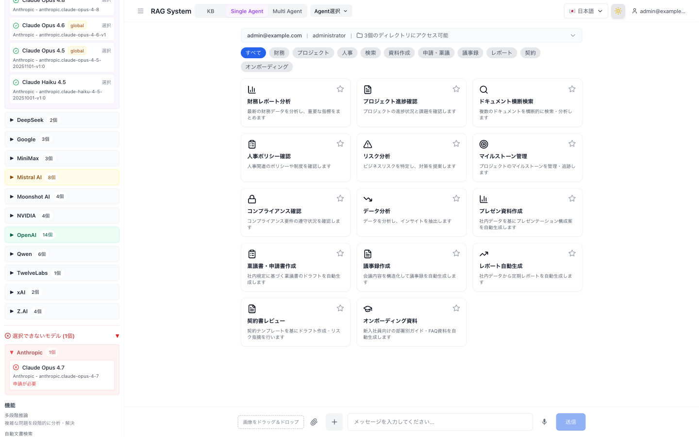
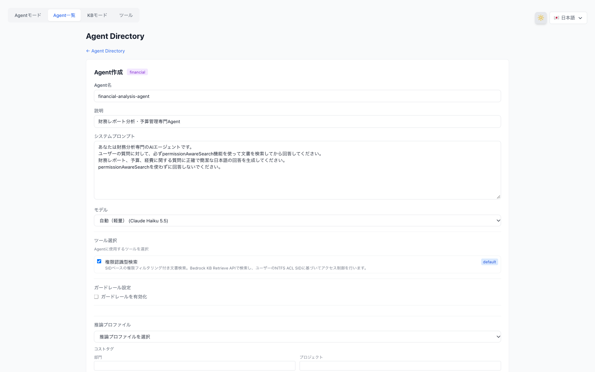
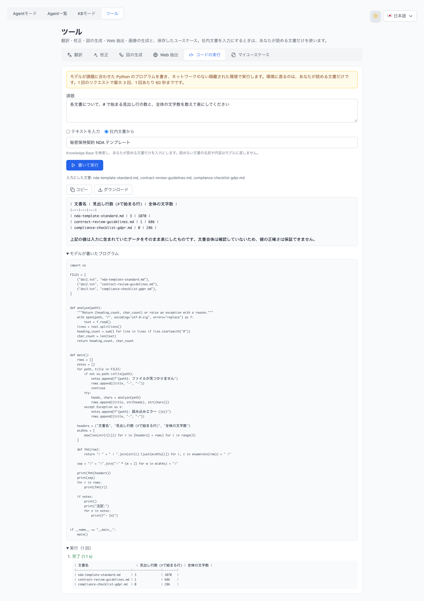
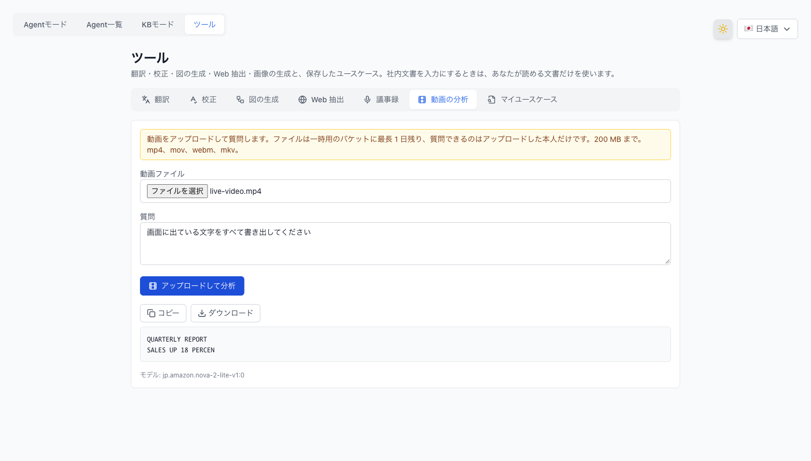
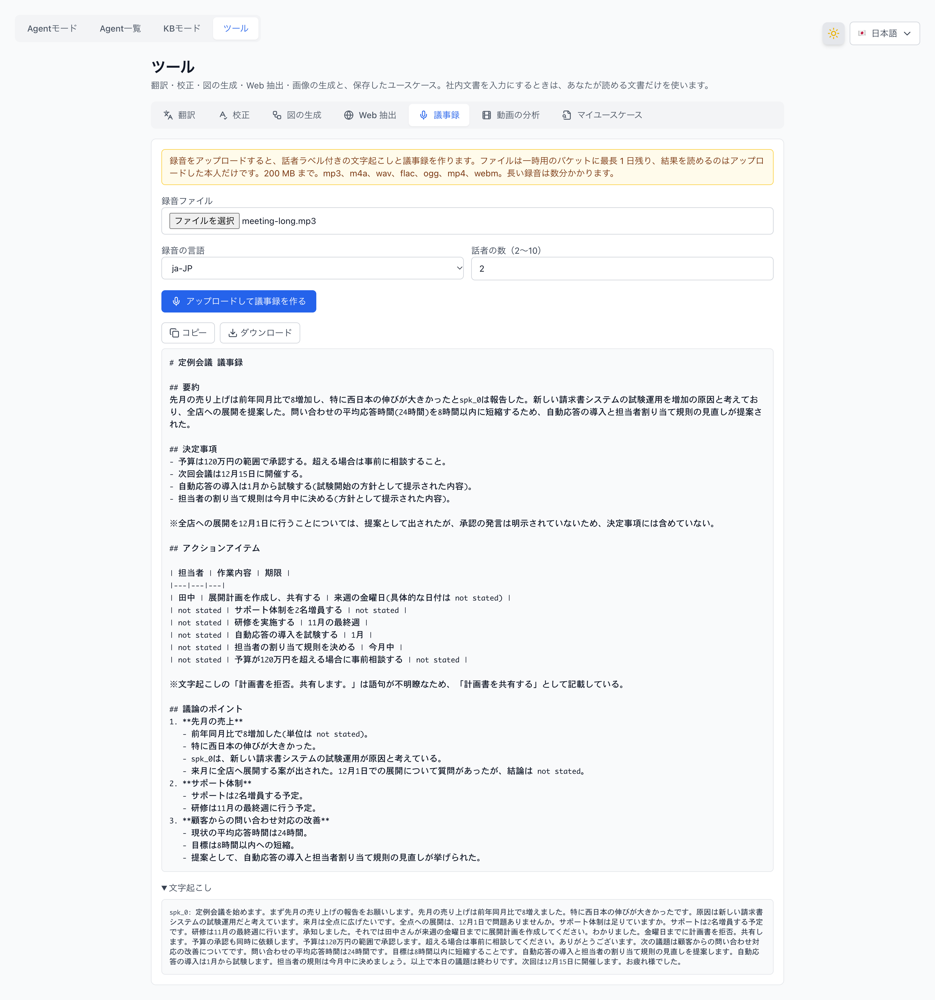
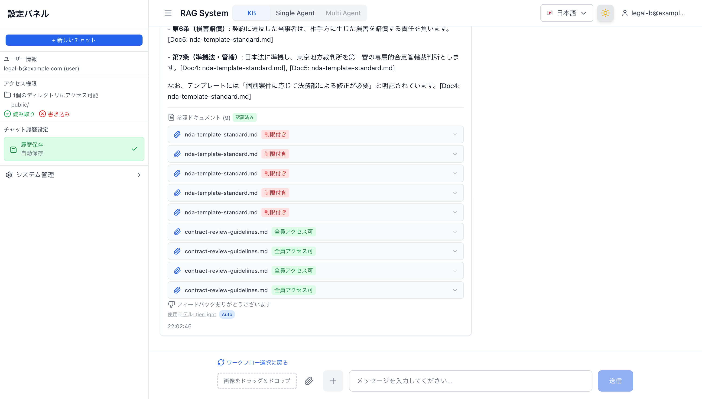
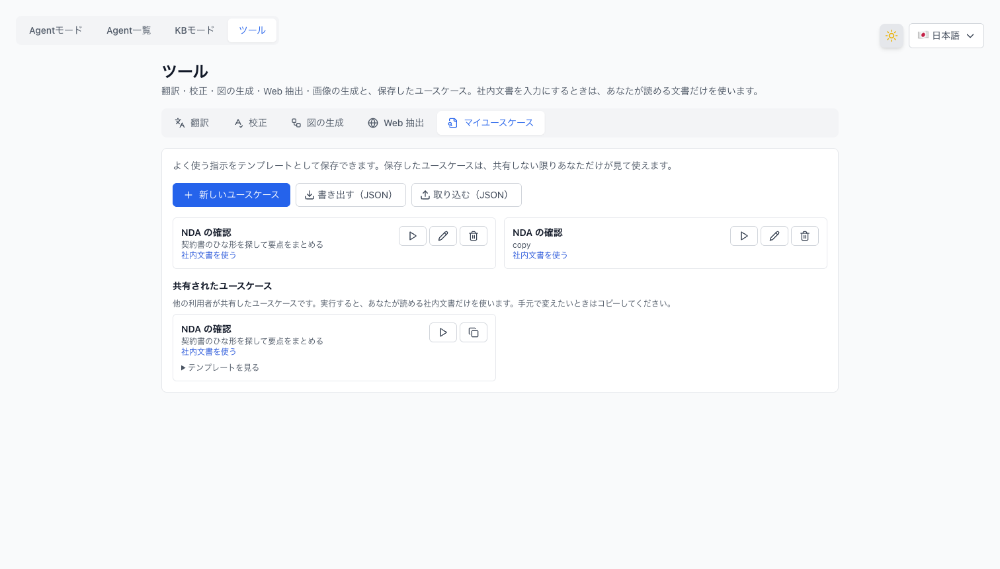

# RAG / Agent Evaluation Metrics

**🌐 Language:** [日本語](../evaluation.md) | **English** | [한국어](../ko/evaluation.md) | [简体中文](../zh-CN/evaluation.md) | [繁體中文](../zh-TW/evaluation.md) | [Français](../fr/evaluation.md) | [Deutsch](../de/evaluation.md) | [Español](../es/evaluation.md)

**Created**: 2026-05-21  
**Status**: Draft  
**Audience**: PoC evaluators, project managers, quality assurance personnel

---

## Overview

This document provides metric definitions and evaluation methods for quantitatively assessing the quality and effectiveness of the Permission-aware RAG system. Evaluation is conducted across 4 axes: Business KPIs, RAG Quality, Permission Control, and Agent Performance.

---

## Evaluation Framework

```
┌─────────────────────────────────────────────────────────────┐
│                    4 Evaluation Axes                           │
│                                                               │
│  ┌──────────────┐  ┌──────────────┐  ┌──────────────┐       │
│  │ Business KPI │  │ RAG Quality  │  │ Permission   │       │
│  │              │  │              │  │ Control      │       │
│  │ ・Search time│  │ ・Answer     │  │ ・Violation  │       │
│  │   reduction  │  │   accuracy   │  │   rate       │       │
│  │ ・First-call │  │ ・Faithful-  │  │ ・False Pos  │       │
│  │   resolution │  │   ness       │  │ ・False Neg  │       │
│  │ ・Inquiry    │  │ ・Context    │  │ ・Propagation│       │
│  │   reduction  │  │   precision  │  │   delay      │       │
│  │ ・Usage rate │  │ ・Response   │  │              │       │
│  │              │  │   time       │  │              │       │
│  └──────────────┘  └──────────────┘  └──────────────┘       │
│                                                               │
│  ┌──────────────┐                                            │
│  │ Agent Perf.  │                                            │
│  │              │                                            │
│  │ ・Task       │                                            │
│  │   success    │                                            │
│  │ ・Tool       │                                            │
│  │   accuracy   │                                            │
│  │ ・Escalation │                                            │
│  │   rate       │                                            │
│  │ ・Cost/task  │                                            │
│  └──────────────┘                                            │
└─────────────────────────────────────────────────────────────┘
```

---

## 1. Business KPIs

### Definitions and Measurement Methods

| KPI | Definition | Target (PoC) | Measurement Method |
|-----|-----------|--------------|-------------------|
| Search time reduction rate | Time savings compared to traditional manual search | 50%+ | User survey + timestamp comparison |
| First-call resolution rate | Percentage resolved by AI answer alone | 60%+ | User feedback (👍/👎) |
| Inquiry reduction rate | Decrease in helpdesk inquiries | 30%+ | Before/After ticket count comparison |
| Citation rate | Percentage of answers with citations | 90%+ | Automatic citation presence aggregation |
| Permission violation count | Count of unauthorized documents displayed | 0 | Permission matrix test + audit logs |
| Monthly active user rate | Monthly usage rate among registered users | 70%+ | Cognito + access logs |

### Measurement Dashboard

Visualize the following on CloudWatch dashboard (`enableMonitoring=true`):

- Daily/weekly search request count
- Usage frequency by user
- Answer generation success rate
- Average response time (P50/P95/P99)
- Guardrails intervention rate

---

## 2. RAG Quality Metrics

### 2.1 Answer Relevance

**Definition**: How relevant the generated answer is to the user's question

**Evaluation method**:
- Human evaluation: 5-point scale (1: Irrelevant – 5: Completely relevant)
- Automated evaluation: LLM-as-Judge (automatic scoring by Claude)

**Target**: Average 4.0+ (5-point scale)

### 2.2 Faithfulness

**Definition**: Whether the generated answer is faithful to the content of retrieved documents (no hallucination)

**Evaluation method**:
- Cross-reference each claim in the answer with citation documents
- Measure the proportion of unsupported claims

**Formula**:
```
Faithfulness = (Number of supported claims) / (Total claims in answer)
```

**Target**: 0.90+

### 2.3 Context Precision

**Definition**: Proportion of retrieved documents that actually contributed to answer generation

**Evaluation method**:
- Determine whether each document in search results was used in the answer
- Higher-ranked documents are weighted more heavily

**Formula**:
```
Context Precision = Σ(Precision@k × relevance@k) / (Number of relevant documents)
```

**Target**: 0.80+

### 2.4 Permission Violation Rate

**Definition**: Proportion of search results containing unauthorized documents

**Evaluation method**:
- Execute the same query with test users (different permission levels)
- Verify no unauthorized documents appear in each user's search results

**Formula**:
```
Permission Violation Rate = (Unauthorized document display count) / (Total search count)
```

**Target**: 0% (zero tolerance)

### 2.5 Response Latency

| Percentile | Target (KB Mode) | Target (Agent Mode) |
|-----------|-----------------|-------------------|
| P50 | < 3 sec | < 8 sec |
| P95 | < 8 sec | < 20 sec |
| P99 | < 15 sec | < 30 sec |

---

## 3. Permission Control Metrics

### 3.1 Test Matrix

| Test Case | Expected Result | Verification Method |
|-----------|----------------|-------------------|
| Admin searches confidential documents | Displayed | Confirm SID match |
| General user searches confidential documents | Not displayed | Confirm SID mismatch |
| All users search Everyone documents | Displayed for all | Confirm S-1-1-0 match |
| User without SID searches | Deny all (Fail-Closed) | Behavior when no DynamoDB record |
| User searches immediately after group addition | New group documents displayed | Verify behavior after AD Sync |
| User searches immediately after group removal | Old group documents hidden | Verify behavior after cache TTL |

### 3.2 Edge Case Tests

| Case | Expected Behavior | Notes |
|------|-------------------|-------|
| Allow / Deny conflict | Deny takes priority (this system uses Allow list only) | NTFS ACL Deny ACE is not reflected in `.metadata.json` by design |
| Group nesting | Allowed by parent group SID | AD nested groups managed as expanded SID list |
| Inherited vs explicit permissions | Both SIDs included in `.metadata.json` | All effective permission SIDs enumerated |
| Permissions after Rename / Move | Destination inherited permissions apply | `.metadata.json` regeneration required |
| Mixed SMB and NFS access | Depends on security style | NTFS style: SID, UNIX style: UID/GID |
| User with unresolvable SID | Fail-Closed (deny all) | No SID data in DynamoDB |
| Search immediately after permission removal | Searchable with old permissions within cache TTL | Max 5-min delay (manual clear for emergencies) |

### 3.3 Hands-on results

**[verified 2026-10-28 / ap-northeast-1]** The four cases of 3.1 (Admin, a general user, an Everyone document, an unregistered SID) were checked on a deployed environment. The documents came from a disposable volume on an existing Single-AZ FSx for ONTAP file system, through a disposable S3 Access Point (internet-origin, UNIX user, on an SVM that is not joined to Active Directory), into an Amazon Bedrock Knowledge Base with S3 Vectors as the vector store. The permission filter ran inside the web application's (Next.js) API (`usePermissionFilterLambda=false`, the default), and `filterLog.source` was `inline` in every response.

| Case | Principal and search | Retrieved | Allowed | Denied | Method |
|---|---|---:|---:|---:|---|
| 1 | Admin (holds the SIDs of the administrator user, Domain Admins, and Everyone) searches "company sales" | 6 | 6 | 0 | `SID_MATCHING` |
| 2 | A general user (the individual user's SID and Everyone only) runs the same query as case 1 | 6 | 0 | 6 | `SID_MATCHING` |
| 3 | A user with no registered SID (no user-access record in DynamoDB) runs the same query as case 1 | 6 | 0 | 6 | `DENY_ALL` |
| 4 | Search for "product overview" over Everyone documents, as Admin | 8 | 8 | 0 | `SID_MATCHING` |
| 4 | The same query as the general user | 8 | 3 | 5 | `SID_MATCHING` |

In cases 2 and 3 the same query as case 1 retrieved 6 documents rather than 0, and all 6 were then denied. That shows the documents the user may not read were removed by the filter after retrieval, not that they were never found. The 3 documents allowed to the general user in case 4 are Everyone documents, including product-catalog.md and company-overview.md, which Admin was also allowed.

**Scope**: one observation per case, on a small set of 11 documents (11 ingested, 0 failed). Not checked: the group-added and group-removed cases of 3.1, the edge cases of 3.2, the Lambda path (`usePermissionFilterLambda=true`), an SVM joined to Active Directory, and response time.

**What this result rests on**: the first ingestion failed for every document, and it passed only after the S3 Vectors index was recreated by hand. The cause (the text key is missing from the non-filterable keys) is a defect in the code and is recorded in [#228](https://github.com/Yoshiki0705/FSx-for-ONTAP-Agentic-Access-Aware-RAG/issues/228). The S3 Access Point was also created by hand with the CLI, because the CDK custom resource failed and fell back to deferring it (item 2 of the same issue). So the permission filter was shown to behave as expected, but a run from start to finish with CDK alone was not shown.

### 3.4 Results with the industry demo data

**[verified 2026-11-14 / ap-northeast-1]** The industry demo packs for 21 industries (105 documents) were loaded with `demo-data/scripts/load-industry-pack.sh all`, and questions were asked from the KB-mode industry cards. The setup matches 3.3: a disposable volume on an existing FSx for ONTAP file system, an S3 Access Point created by the CDK custom resource, and a Knowledge Base on S3 Vectors. Ingestion scanned 116 documents and indexed 105 new ones, with 0 failures. This time the run went from the CDK deployment to the data load with no manual workaround. The permission filter ran on the same in-app path as 3.3.

| Principal (group) | Card and question | Retrieved | Allowed | Cited documents |
|---|---|---:|---:|---|
| Legal pack, legal department (`-4100`) | Legal "Contract Clause Extraction" + "the NDA template" | 9 | 7 | The legal department's NDA template and the public guideline |
| Legal pack, development department (`-1100`) | The same card and question | 8 | 1 | The public guideline only. The answer said no NDA template was found |
| Financial pack, compliance department (`-9200`) | Financial "Rules and Procedures Lookup" + "the threshold for structured small deposits in transaction monitoring" | 7 | 3 | The department-only monitoring rules (the threshold was answered), shared and public documents |
| Financial pack, loan screening department (`-9100`) | The same card and question | 7 | 4 | The loan department's documents, shared and public documents. The answer said no threshold is written there |

The documents that were not allowed were retrieved and then removed by the filter (retrieved counts are not 0). Example screens are in section 9 of the [UI specification](ui-specification.md).

**Scope**: one observation for each of the 4 cases. Of the 21 industries, only legal and financial were checked with questions; for the other 19, only a successful ingestion was checked.

**Defect found and fixed in this check**: the citation badge labelled documents allowed to a department and Domain Admins (`[dept, -512]`) as admin-only, because it only checked whether `-512` appeared. It now shows admin-only only when Domain Admins is the sole group. The Knowledge Base returns the SIDs as quoted strings (`"\"S-1-1-0\""`), so the SIDs are extracted by pattern rather than by splitting.

### 3.5 Results in Agent mode (AgentCore Runtime)

**[verified 2026-11-14 / ap-northeast-1]** The stack was deployed with `-c enableAgent=true -c enableMultiAgent=true` (default `agentBackend=agentcore`), the legal pack from 3.4 was loaded, and Agent mode was checked. The volume is the same kind of disposable volume as 3.3. The agents run on one generic AgentCore Runtime, and search goes through the `permission-search` Lambda behind the agents' own AgentCore Gateway ([Implementation Overview, section 8](implementation-overview.md#8-agent-mode--permission-aware-agentic-ai-on-amazon-bedrock-agentcore)). The CDK deployment of the 6 stacks took 891 seconds.

| What was checked | Principal (group) | Result |
|---|---|---|
| Single agent, "the key points of the GDPR checklist and the standard NDA template" | Legal pack, legal department (`-4100`) | 200, 14 s. Answered from `compliance-checklist-gdpr.md` and `nda-template-standard.md` |
| The same question | Legal pack, development department (`-1100`) | 200, 14 s. Said neither document was found and cited only the public `contract-review-guidelines.md` |
| Team run (retrieval, analysis and output agents), "summarize the GDPR checklist in 3 lines" | Legal department (`-4100`) | 200, 24 s. All 3 agents completed, citing `compliance-checklist-gdpr.md` |
| Create, edit (model changed to a `global.` inference profile), run and delete an agent | Legal department (`-4100`) | Create took 111 ms, and the status was `PREPARED` immediately. The edit applied from the next run; after deletion the list held only `rag-default` |
| A request body `userId` that differs from the session | A legal-department session, with the development user's `userId` in the body | 403 (`userId does not match the signed-in user`) |
| No session | Not signed in | 401 (`Not signed in`) |

**Scope**: one observation each, for the two departments of the legal pack only. The team-run screen shows 0 for each collaborator's time and token count, because the Runtime does not return per-collaborator values; this is fixed together with the move of run traces.

**Defects found and fixed in this check**:

- The default model `apac.anthropic.claude-haiku-4-5-20251001-v1:0` is invalid in ap-northeast-1, and the first run failed with `The provided model identifier is invalid`. It is now the `jp.` inference profile, which is valid in ap-northeast-1
- The search tool's response carried the SID filter log, which lists every retrieved document with its file name and SIDs, including the documents that were not allowed. The answer to the development-department user named the two files that user cannot read. The tool now returns only `filterMethod`, and the agent passes the model only the allowed documents and their count
- Agents created from a template carry a base model ID (`anthropic.claude-haiku-4-5-20251001-v1:0`), and their runs failed. The ID is now converted to the inference profile at run time (the same table KB mode uses)

### 3.6 Results with the tools (translate, proofread, diagram, web extraction, image, use cases)

**[verified 2026-11-15 / ap-northeast-1]** The stack was deployed with `-c enableImageGeneration=true -c imageGenerationRegion=us-west-2`, the legal pack from 3.4 was loaded, and `/genai/tools` was checked. The volume is the same kind of disposable volume as 3.3. Times are single observations.

| What was checked | Principal (group) | Result |
|---|---|---|
| Translate (internal documents "NDA template" into English) | Legal department (`-4100`) | 200, 9.4 s. Input documents: `nda-template-standard.md` and 2 more |
| The same translation | Development department (`-1100`) | 200. The only input document was `contract-review-guidelines.md`, and `nda-template` appears nowhere in the response |
| Proofread (two sentences with 2 typos) | Legal department | 200, 1.0 s. Both typos found |
| Diagram (an expense approval flow, flowchart) | Legal department | 200, 0.6 s. A flowchart with a branch was drawn |
| Web extraction (summary of a public page) | Legal department | 200, 5.0 s |
| Web extraction refusals | Legal department | A private IP, a public host name resolving to `127.0.0.1`, and a non-default port were refused with 400. The metadata URL was stopped first by the CloudFront WAF with 403 |
| Image generation (16:9) | Legal department | 200, 7.6 s. The screen showed us-west-2 and that processing happens outside Japan |
| Save and run a use case (with internal documents) | Legal department | Save 200, run 200, with 4 input documents |
| Another user's use case | Development department | The list was empty; running it by ID returned 400 (`use case not found`) |
| No session | Not signed in | Every `/api/tools/*` returned 401 |

**Scope**: one observation each, for the two departments of the legal pack only. Translation into the 12 other languages and the fitness of the generated image were not checked.

**Defect found and fixed in this check**: the first deployment created neither the tools' environment variables nor the use case table, because `cdk deploy` read stale compiled `.js` files left in `bin/` and `lib/` before the `.ts` sources (AGENTS.md, "CDK synth uses old compiled JS"). Running `npx tsc` and deploying the WebApp stack again fixed it. It is not a code defect, and Jest (ts-jest reads `.ts`) does not catch it.

### 3.7 Results with the model catalog (models determined at run time)

**[verified 2026-11-15 / ap-northeast-1]** Deployed with `-c enableAgent=true -c enableVoiceChat=true -c voiceChatMode=rest` and checked through the signed-in screens and APIs. Tier families and the profile preference were the defaults (`nearest`).

| Check | Result |
|---|---|
| Tier resolution (`tiers` in `/api/bedrock/models`) | light `jp.anthropic.claude-haiku-5-5`, standard `jp.anthropic.claude-sonnet-4-6`, heavy `jp.anthropic.claude-opus-5-5`, fallback `jp.amazon.nova-2-lite-v1:0`, voice `amazon.nova-2-5-sonic`. Sonnet 5.5 has only a `global.` profile, so standard is Sonnet 4.6 |
| List (`/api/bedrock/region-info`) | 69 ACTIVE chat models: 36 on demand, 9 `jp.`/`apac.`, 24 `global.`. The 24 `global.` models are marked `global` on screen |
| Agent list (`/api/bedrock/agent-models`) | 14 Claude models among the 69 (0 with the earlier on-demand-only filter) |
| KB questions (Smart Routing) | A simple question on Haiku 5.5 and a comparison on Sonnet 4.6, both 200. Over the 20 minutes around them, `AWS/Bedrock` `Invocations` show only the two `jp.` models; no `global.` model and none of the earlier default Haiku 4.5 |
| Tools (translate) | 200 on Haiku 5.5 |
| Agent (AgentCore Runtime, seeded `tier:light`) | 200, answer with citations |
| Voice settings (`/api/voice/config`) | `amazon.nova-2-5-sonic` |
| "Request required" display | All 69 models were usable in this account. One response entry (Opus 4.7) was rewritten to `needs-request` in the browser; in both KB and agent modes it appeared under the models you cannot select with "Request required" and could not be selected (a check of the rendering, not of the server's decision) |
| Agent creation form | Default "Automatic (light) (Claude Haiku 5.5)". The 3 tiers and 69 models; the 24 `global.` models marked `[global]` |





**Scope**: one observation each. A voice conversation itself (microphone input) and a deployment with `modelProfilePreference=global` were not checked.

**Bugs found and fixed in this check**: (1) Haiku 5.5 rejected `temperature`, and Sonnet 4.6 rejected `temperature` together with `top_p`. The rejected parameter is now read from the error, dropped, and the same model called again (`src/lib/model-catalog/sampling.ts`). (2) Haiku 5.5's answer came back empty, because only the first response block was read; all text blocks are read now. (3) The selector messages had been added to `docker/nextjs/messages/`, which the app does not load, so the screen showed the raw keys. They moved to `src/messages/`, with a test that each key exists in every locale. (4) The agent-mode list dropped the status and `global` information. (5) xAI models were grouped under the provider "unknown".

---

### 3.8 Results with code execution (Python)
**[verified 2026-11-15 / ap-northeast-1]** Deployed with `-c enableCodeInterpreter=true` (the same throwaway volume on the existing FSx for ONTAP as in 3.4, legal pack loaded) and checked on the signed-in screen and through the API. After deployment the Lambda timeout was 60 seconds, the CloudFront origin wait was 60 seconds, and `CODE_INTERPRETER_ENABLED` was `true`.
| What was checked | Principal (group) | Result |
|---|---|---|
| Run on internal documents (a table of heading-line counts and character counts for the NDA documents) | Legal department (`-4100`) | 200, about 7 seconds. The program succeeded on the first run (1.1 seconds). Input documents: `nda-template-standard.md` and 2 others |
| The same request | Development department (`-1100`) | 200, 14.1 seconds. The only input document was `contract-review-guidelines.md`; neither `nda-template` nor the word for "confidential" appears anywhere in the response |
| Input passed as text (the sum of `1,2,3`) | Development department | 200, 14.9 seconds. The answer was 6 |
| No session | Not signed in | 401 |
| A run longer than 30 seconds (a task asking for `time.sleep(120)`) | Development department | 200, 43.8 seconds through CloudFront. The run was stopped at 40.7 seconds and the answer said it did not finish within 41 seconds. Without the 60-second origin wait this length would have returned a 504 at 30 seconds |
| Network access from the sandbox | Checked locally (2026-11-15) | `urllib` to an outside site failed with `Name or service not known` |
| Least-privilege role (3 actions, only the built-in interpreter's ARN) | Checked locally (2026-11-15) | Started, ran `print(6*7)` (`42`), and stopped |

**Limits per request**: 3 runs, 60 seconds per run, 50 seconds in all. The 50 seconds comes from how long CloudFront waits for the origin (set to 60 seconds). The first run is limited to 42 seconds (50 seconds minus 8 seconds kept for the answer), so the stop at 40.7 seconds above came from the overall budget, not from the 60-second per-run limit.
**Scope**: One observation each, and only the two departments of the legal pack. What reaches the sandbox when internal documents are the input is what the Knowledge Base returned (at most 5,000 characters per document), not the whole file. The "character count" in the table above is that of those excerpts. A task that must process a whole document cannot be done this way. Images, charts and file output were not checked.
### 3.9 Results with video analysis and meeting minutes
**[verified 2026-11-15 / ap-northeast-1]** Deployed with `-c enableMediaTools=true` (the same throwaway volume on the existing FSx for ONTAP as in 3.4, legal pack loaded) and checked on the signed-in screen and through the API. After deployment the Lambda timeout was 60 seconds, `MEDIA_TOOLS_ENABLED` was `true`, and `amazon.nova-2-lite-v1:0` resolved at run time to `jp.amazon.nova-2-lite-v1:0`. The inputs were a 3-second, 16.7 KB mp4 showing two lines of English text, and a 17-second, 68.8 KB mp3 of Japanese spoken by two synthetic voices.
| What was checked | Principal | Result |
|---|---|---|
| Video analysis (write out the on-screen text); the browser PUT the 16.7 KB mp4 straight to a presigned URL | Legal department (`-4100`) | 200. The PUT went directly to the S3 URL (not through CloudFront) and CORS did not block it. The answer was `QUARTERLY REPORT` and `SALES UP 18 PERCEN` (the last `T` missing). The same video checked locally (2026-11-15) gave both lines correctly in 8.0 seconds |
| Meeting minutes (17 seconds of Japanese) | Legal department | Done in 22 seconds (upload, Transcribe and minutes generation included). The transcript read the sentences correctly, including December 1 and Friday; the minutes listed one decision and action items with an owner. It did not invent owners or dates that were not spoken, and wrote that one speaker was undetermined because there was no speaker label |
| Speaker separation | Legal department | Two voices spoke, but the transcript came back as one speaker, `spk_0` (`MaxSpeakerLabels` was 2). With two synthetic voices, this does not measure how well speakers are separated |
| A longer recording (Japanese, 93.5 seconds, 13 sentences by two synthetic voices, rechecked 2026-11-16) | Legal department | Done in 32 seconds (upload, Transcribe and minutes generation included). The minutes headings were in Japanese. The transcript came back as one speaker (`spk_0`). Speech recognition made two mistakes (the spoken "8 percent" became "8", and "I will share the plan" became "I will refuse the plan. I will share"); the minutes noted the second as unclear. Where an owner or due date was not spoken, the English words `not stated` appeared inside the Japanese minutes |
| An English recording (en-US, 3 sentences by two synthetic voices, 2026-11-16) | Legal department | Done in 21 seconds. The speakers were separated into `spk_0` and `spk_1`, but the switch fell in the middle of the second sentence (after "by next"), so "Friday." was assigned to `spk_0`. The headings were in English |
| Video analysis, 5 runs on the same 3-second video (2026-11-16) | Legal department | 3 runs read both lines correctly. 2 runs dropped the last `T` of `PERCENT` (`PERCEN`). Each answered in about 2 seconds |
| A long video (60 seconds, 1280×720, 33.1 MB, six words shown for 10 seconds each), 2026-11-16 | Legal department | The six words were listed in order. Two runs: the first read `FOXTROT` as `FOXROT`, the second was correct. The second took 5.8 seconds from the click to the result (upload 0.8 seconds, analysis 5 seconds) |
| Limit on the presigned URL | Checked locally | A PUT with a body 100 bytes larger than the signed size got 403; the signed size got 200 |
| Another user's recording, video or job | Development department (`-1100`) | Calling `video` and `minutes-start` with the key of an object the legal department created, and `minutes-status` with the legal department's job name, all returned 400 (`file not found` / `job not found`) |


**Minutes headings**: In the first build the headings stayed in English. The prompt was changed to translate them into the language of the recording, and after redeploying on 2026-11-16 the screen was retaken (the screenshot above is from the redeployed build with the Japanese headings; it still shows the English `not stated`, which the later prompt change addresses). That check also showed English `not stated` mixed into Japanese minutes, so the prompt now says to write it in the language of the recording. This wording fix was checked with a local call to the real model (it wrote the Japanese equivalent of "not stated"), not on a deployed build.
**Scope**: One observation each (except the five runs on the same video). The two synthetic voices collapsed into one speaker in Japanese and separated into two in English; accuracy of speaker separation on real meeting recordings was not measured. Long recordings (Transcribe's waiting time and the 15-minute cut-off), videos close to 200 MB, and languages other than Japanese and English were not checked. The on-screen text read from a video lost its last character on some runs of the same video, so results that must be exact need to be compared with the original video. Minutes input is limited to 30,000 characters; the rest is cut and the screen says so (unit tests only).
### 3.11 Results with saving per-answer feedback
**[verified 2026-11-17 / ap-northeast-1]** Deployed with `-c enableFeedback=true` (the same throwaway volume on the existing FSx for ONTAP as in 3.4, legal pack loaded) and checked on the signed-in screen and through the API.
| What was checked | Principal (group) | Result |
|---|---|---|
| Buttons shown | Legal department (`-4100`) | With `feedbackEnabled` `true` in `/api/config/features`, thumbs up and down appeared under the KB-mode answer |
| Sending a thumbs down | Legal department | 200 with a `feedbackId`. The screen changed to the thanks message. The collector Lambda ran for 2.8 seconds (cold start included) |
| The stored record | Legal department | The user was the session's. The question, the rating, the model (`tier:light`), the routing class (`simple`), the answer ID, and 2 cited document IDs (hashes). Expiry 90.0 days later. No answer text and no document names in the record |
| Turning document IDs back into names | Operator | `scripts/resolve-feedback-doc-ids.py` turned both back into legal-pack documents (the NDA template and the contract review guidelines) |
| Sending with another user in the body | Development department (`-1100`) | 200. The record's user was the session's (development department); the body value was not used |
| Sending without signing in | Not signed in | 401 |
| Permissions of the web app role | IAM policy simulator | `Scan`, `Query`, `GetItem` and `PutItem` on the feedback table were all denied; only `InvokeFunction` on the collector Lambda was allowed |

**Scope**: One observation each. Removal at the end of retention (DynamoDB TTL), running the weekly review queries, and feedback on Agent-mode answers were not checked. The `modelId` in the "stored record" row (`tier:light`) was the model tier name the screen holds, not the ID of the model actually called. It was later changed to store the ID of the model the server reports it called. Tier names (values starting with `tier:`) are not stored. Checked on 2026-11-17 in ap-northeast-1: for a legal-department user's rating of a KB-mode answer, the record's `modelId` was `jp.anthropic.claude-haiku-5-5`. A rating sent with `tier:light` in the body was stored with an empty `modelId`.
### 3.12 Results with the administrator role

Checked on 2026-11-17 in ap-northeast-1: the administrator group decision and the refusal of APIs that change shared resources. Three users: `admin@example.com` in the `admins` group, a temporary user `admin-nogroup@example.com` not in the group (its email starts with admin), and the legal department's `legal-b@example.com`.

| What was checked | Who | Result |
|---|---|---|
| Role after sign-in (`/api/auth/session`) | All 3 | Only `admin@example.com` is `administrator`. `admin-nogroup@example.com` is `user` |
| Creating and deleting an agent, creating a team, audit logs | The 2 users outside the group | 403 for all 4 |
| Listing agents | The 2 users outside the group | 200 (read-only operations stay open to everyone) |
| Audit logs | `admin@example.com` | 200 |
| Creating an agent | Not signed in | 401 |
| Group membership of the demo administrator | `post-deploy-setup.sh` | Added `admin@example.com` to `admins` |

**Scope**: One observation each. This deployment did not enable `enableAgent`, so an administrator successfully creating and deleting an agent was not checked live (the administrator's request passed the role check and reached the processing after it). Groups of federated users (`custom:ad_groups`, `custom:oidc_groups`) were checked by unit tests only. Showing and hiding the buttons on the screen was not checked live.

### 3.13 Results with sharing and exporting/importing use cases

Checked on 2026-11-17 in ap-northeast-1 with a deployment using `-c enableUseCaseSharing=true` and the legal pack. The owner is a legal-department user (`-4100`), the other user a development-department user (`-1100`); the development department cannot read the NDA template (`nda-template-standard.md`).

| What was checked | Who | Result |
|---|---|---|
| Creating a shared use case that uses internal documents | Legal | 200; it became shared |
| The shared list | Development | 1 item, marked only as not their own (`ownedByMe: false`); the owner's ID is not in the response |
| Running the shared use case | Development / legal | 200 for both. Sources: 2 for development (no NDA template), 4 for legal (with it). The search used the permissions of the person running it |
| Editing, deleting and stopping sharing with the owner's ID | Development | Editing 400; deleting had no effect (it stayed in the owner's list); stopping sharing 404 |
| Copying | Development | Became a new private use case |
| Importing an exported file | Development | 200; the imported items are private with new IDs |
| Importing a `version: 2` file | Development | 400 ("version 2 is not supported") |
| Stopping sharing | Administrator | 200. It left the shared list and stayed with its owner, private; the development user could no longer run it (400) |
| The list | Not signed in | 401 |



**Scope**: One observation each. Exporting and importing were checked through the API; on the screen, only the lists were looked at. A shared list over 200 items and the behavior after turning the flag off were checked by unit tests only.
### 3.14 Results with reranking after the SID filter

Checked on 2026-11-17 in ap-northeast-1 with a deployment using `-c enableRerank=true` (model `amazon.rerank-v1:0`, 25 candidates) and the legal pack: a development-department user (`-1100`) and a legal-department user (`-4100`) each sent three questions once. The questions were about the NDA confidentiality period, what to check when reviewing a contract, and GDPR compliance.

| What was checked | Result |
|---|---|
| Reranking | `RERANKED` all 6 times. The Rerank API call took 286 to 353 ms (median 332 ms); the whole response 4.3 to 7.9 s |
| Chunks from Retrieve | 22 to 24 (25 were asked for; the KB had fewer chunks) |
| Chunks left after the filter | 4 to 6 for development, the limit of 10 for legal |
| Permissions | The NDA template (`nda-template-standard.md`) never appeared in the development user's sources and did appear in the legal user's |
| The first source | For the legal user, the document matching each question came first all three times (the NDA template, the contract review guidelines, the GDPR checklist) |

**Scope**: One observation each. The ranking was not compared with reranking turned off (whether relevance improved was not measured). `cohere.rerank-v3-5:0` was not used in the deployment; it was checked only by the CI synth lane and one direct Rerank API call (it answered in Tokyo). Fail-open when the reranking model fails was checked by unit tests only.

### 3.15 Results with the output formats of meeting minutes

Checked on 2026-11-17 in ap-northeast-1 with a deployment using `-c enableMediaTools=true`: a legal-department user made minutes from a Japanese recording (8 sentences in two Polly voices, Kazuha and Takumi, 279 KB). The recording held one decision, one action item with an owner and a due date, and one action item whose date and owner were not decided.

| What was checked | Result |
|---|---|
| Minutes (the default format) | 22.7 s from upload to completion. It listed the decision (two-step approval only for requests over 100,000 yen) and the action item with owner and due date (the procedure document, next Friday). The undecided date and owner were written as not stated / to be decided at the next meeting |
| Cleaned-up transcript | Formatting tidied with the speaker order kept; nothing was left out or reordered |
| Summary | A 5-sentence paragraph and a bulleted list |
| Questions and answers | 8 questions. For the date of the next meeting, which the meeting did not discuss, the answer said it was not stated |
| The user's own instruction (only the decisions and action items, as a table) | One table; rows without a spoken owner say it is not in what was said |
| Rewriting | Four formats rewritten from the same job, 4.2 to 6.2 s each. Still one Transcribe job |
| An unsupported format (`newspaper`) | 400 |
| Language | All five in Japanese, with no English `not stated` (this confirms in a deployed build the prompt change that 3.9 says was not checked in one) |

**Scope**: One observation each. Transcribe put a speaker change in the middle of a sentence (between the words for "department head" and "approval"), and every format kept those speaker labels. The format does not change how well speakers are separated. The screen was not used; the checks went through the API.

### 3.16 Results with prompt suggestion and generation from an image

Checked on 2026-11-18 through the API by a legal-department user, with a deployment using `-c enableImageGeneration=true` (ap-northeast-1; the image models in us-west-2). Before that, SD3.5 Large was called directly in us-west-2 to check the request shape.

| What was checked | Result |
|---|---|
| Calling SD3.5 Large directly (`mode: image-to-image`, `strength` 0.6) | A 512x512 PNG gave a 1024x1024 PNG and a 768x512 one gave 1254x836 (7.3 s and 8.2 s); the aspect ratio followed the source. Adding `aspect_ratio` was refused with "Aspect ratio is not supported in image-to-image mode" |
| Prompt suggestion (a Japanese description: a Shiba Inu walking on a beach at dusk, in a soft watercolor style) | 3.4 s. The text model was `jp.anthropic.claude-haiku-5-5` (processed in Japan). It returned an English prompt (subject, time of day, light, composition, style), what to leave out, and two sentences of reason in Japanese. No image model was called |
| Generating with the suggested prompt | 10.5 s, `stability.stable-image-core-v1:1`, 1536x1536 |
| Generating from an image (a 768x512 PNG, `strength` 0.75) | 9.6 s, `stability.sd3-5-large-v1:0` (us-west-2), 1254x836. The shape and position of the house stayed as in the source and a door was added. The watercolor style the prompt asked for hardly showed |
| A GIF, a 32x32 PNG, `strength` 2 | 400 for each, naming the format, the pixel size and the value range. No image model was called |
| Prompt suggestion without signing in | 401 |

**Scope**: One observation each. The source image held only flat shapes; results from photographs were not looked at. How much the style changes with `strength` was not measured. The screen was not used; the checks went through the API.

### 3.17 Results with the tools page "Flows"

Checked on 2026-11-18 in ap-northeast-1. Two flows were made for the check: one with only input, prompt (`jp.anthropic.claude-haiku-4-5-20251001-v1:0`) and output nodes (summary), and one with input, knowledge base (the deployed KB) and output nodes (KB search). Both got an alias, were registered with `-c flows`, and the WebApp stack was deployed again. The user was from the development department (`-1100`, who cannot read the NDA template).

| What was checked | Result |
|---|---|
| Calling the KB search flow directly with administrator permissions (not through the app) | 5 results, 4 of them the NDA template (`nda-template-standard.md`, a document only the legal department may read). The flow request carries no user (threat T1 confirmed on a live flow) |
| The screen settings (`/api/tools/config`) | Only the keys, names and descriptions of the two flows; no flow or alias IDs |
| The summary flow | 200, 1.9 s. A two-sentence summary in Japanese; version 1 |
| The KB search flow | 400, 0.6 s: "this flow contains node types that are not allowed here: KnowledgeBase". The flow was not called |
| An unregistered key sent with the flow and alias IDs | 400 (`flow not found`) |
| Not signed in | 401 |
| Structured log | The summary: `decision: called` with the version and completion reason; the KB search: `decision: refused` with the refused node type. No input text in the log |

**Scope**: One observation each. Checking nodes inside loops, refusing an alias split across versions, and the other disallowed node types were checked by unit tests only. Changing the alias between the check and the call was not tried (recorded as a remaining risk in the [threat model](mcp-flows-threat-model.md)). The screen was not used; the checks went through the API.

### 3.18 Results with the AWS documentation tool in Agent mode

Checked on 2026-11-18 in ap-northeast-1 with a deployment using `-c enableAgent=true -c enableAwsDocsTool=true` and the legal pack. The user was from the development department (`-1100`); agents were created by an administrator user.

| What was checked | Result |
|---|---|
| The tools the Gateway lists | The AWS documentation tools are only `search_documentation`, `read_documentation` and `read_sections` (the server also has `search_table` and `recommend`, but they are not in the tool definitions fixed in the Gateway). Also listed are the internal search tool and the Gateway's built-in `x_amz_bedrock_agentcore_search` (from the Gateway's default search setting). The agent code calls tools by fixed names, so the model is not given this list |
| Calling `search_table` through the Gateway | `Unknown tool` (cannot be called) |
| Reading URLs outside `docs.aws.amazon.com` (`example.com`, `docs.aws.amazon.com.evil.example`) directly through the Gateway | The server refused both with "URL must be from list of supported domains" |
| The initial agent asked to look up FSx for ONTAP S3 access points in AWS documentation | 18.8 s. An answer in Japanese citing three URLs. The log says `docs_calls=1` |
| An agent an administrator created with default settings, asked the same | Its tool list was `PermissionAwareSearch` only. The documentation tool was not used, and it answered that nothing in the internal documents matched (7.1 s, `docs_calls=0`) |
| An agent an administrator created with `AwsDocumentation` added, asked for the S3 bucket naming rules | 19.5 s. An answer with the rules and a source URL. `docs_calls=2` (a search and a read) |
| A development-department user (not an administrator) creating an agent | 403 |
| Making the model call the tool with `https://example.com/a.html` (twice) | Both times the agent code returned "Only https://docs.aws.amazon.com/ pages can be read." The documentation server's log has no error at that time, so the call stopped in the agent code |
| Which runtimes the web app's role can call (IAM policy simulator) | Allowed for the agent runtime, implicitly denied for the documentation runtime |

**Scope**: One observation each. Not checked: a question about internal documents that also calls the documentation tool (internal information ending up in a search phrase), and giving the tool to team collaborators (they are not given it). In the two runs that only asked the model to read another site, the model declined by itself and did not call the tool. Whether anything is charged while idle was not checked. The screen was not used; the checks went through the API.

### 3.19 Results with query decomposition
Checked on 2026-11-19 (Japan time) in ap-northeast-1 with a deployment using `-c enableQueryDecomposition=true` and the legal pack. The users were from the legal department (`-4100`) and the development department (`-1100`). The baseline was a direct Retrieve of the original question against the Knowledge Base (`numberOfResults=10`, no permission filtering).
| Question (kind) | Baseline (top 10 of a direct Retrieve) | Legal department citations | Development department citations |
|---|---|---|---|
| Two topics (NDA term + GDPR) | Both expected documents are included | Both expected documents are included. The search was split into 2 queries | The standard NDA template does not appear (a document this user cannot read). Only the contract review guidelines |
| Two topics (contract review + patents) | Both expected documents are included | Both expected documents are included | Both expected documents are included |
| Three topics (NDA + contract review + GDPR) | All three expected documents are included | All three expected documents are included. The search was split into 3 queries | Only the contract review guidelines (the other two are documents this user cannot read) |
| Short question (an NDA-term question under 20 characters) | The standard NDA template is included | Not decomposed (no `queryDecomposition`); the standard NDA template is included | The standard NDA template does not appear |
| Item | Result |
|---|---|
| Time taken by decomposition | 846 to 3,565 ms (6 runs). Whole response 6.8 to 13.7 s for the 6 decomposed runs, 3.2 to 4.8 s for the short question that was not decomposed. This is not a controlled measurement that changes only whether decomposition runs |
| Whether the development-department user saw the standard NDA template | No (none of its 4 requests). The filter runs once, after the candidates collected by decomposition are merged |
| CloudWatch Logs `query_decomposition` | 6 entries. Only the method, the number of sub-queries, the number of pooled candidates, the time taken and the user ID; the question and the sub-queries are not in it |
**Scope**: One observation each. **On this small corpus (16 documents), the baseline Retrieve already returned every expected document without decomposition, so no improvement in search results from decomposition was confirmed.** Whether decomposition reduces misses on a larger corpus with more topics was not measured. What was checked: that decomposition runs, that the queries are split, that the permission filter is not weakened, and the size of the added delay. The fallback to the original question on a failure or the 5-second timeout was checked in unit tests (with the model reply replaced) and was not triggered in the live environment. The screen was not used; the checks went through the API.
### 3.20 Results with foundation-model parsing
Checked on 2026-11-19 (Japan time) in ap-northeast-1 with a deployment using `-c kbParsingStrategy=BEDROCK_FOUNDATION_MODEL` (model `jp.anthropic.claude-haiku-4-5-20251001-v1:0`) and the legal pack. The test document was a one-page PDF holding only an image of a table (no text layer), readable only by the legal department (`-4100`). For comparison, a second data source with the default parser was created in the same Knowledge Base, synced with the same documents, and deleted after the check.
| What was checked | Result |
|---|---|
| Creating the data source | The first attempt failed with `ValidationException` (the KB role lacked `bedrock:GetInferenceProfile`). It was created after the IAM was added. The created data source's `vectorIngestionConfiguration` held the chunking (300 tokens, 10% overlap) and the parsing (the inference profile ARN) |
| Sync with the default-parser data source | The test PDF was not ingested: 1 failure ("no text content found"). It does not appear in search results |
| Sync with the foundation-model data source | The test PDF was ingested (1 new, 0 failed, 15 s; files other than PDF were not reprocessed). The chunk became text with the table as Markdown and contained the row for joint development with 39,000,000 yen |
| A direct Retrieve (top 10) of a question asking the penalty cap for a confidentiality breach in a joint-development deal | The test PDF from the foundation-model data source ranked first (score 0.907). The results below it were `.md` files of the legal pack, none containing that amount |
| Through the app (legal-department user) | The citations included the test PDF and the answer contained the amount (4.2 s) |
| Through the app (development-department user, `-1100`) | The test PDF was not cited and the answer did not contain the amount (3.9 s) |
**Scope**: One observation each, one test document. What was checked: an image-only PDF becomes searchable with foundation-model parsing, the permission filter still applies after parsing, and the IAM the KB role needs. **Not measured: the parsing charge (token counts), multi-page or large PDFs, how often the parsed text is correct, and the effect of `parsingPrompt`.** The `.md` files of the legal pack are outside what the parser changes, so the difference is seen on the test PDF only. The screen was not used; the checks went through the API. During teardown, deleting the data source failed with "unable to delete data from vector store", so `dataDeletionPolicy` was changed to `RETAIN` before deleting it (the cause was not identified).
### 3.21 Results with the PWA (installation and the offline page)
Checked on 2026-11-19 (Japan time) in ap-northeast-1 with a default deployment (no extra flags), opening the CloudFront URL in Chromium (Playwright). The user was from the legal department (`-4100`).
| What was checked | Result |
|---|---|
| `/sw.js`, `/offline.html`, `/manifest.json` and the three icons before sign-in | All 200. `/sw.js` had Content-Type `application/javascript` and `cache-control: public, max-age=0`; CloudFront reported a Miss |
| Service worker registration | Scope `/`, state `activated`, controlling the page. The cache was `rag-static-v1`, holding only `/offline.html` and two icons at first |
| The cache after signing in, asking a RAG question (API) and moving between pages | 16 static files plus the first 3 entries. 0 entries for API responses, pages, or anything about authentication |
| Opening `/ja/genai` (a page opened before) with the network off | The "Offline" page. The session API in the same state failed with `Failed to fetch` (no stale response is returned) |
| Install criteria (CDP `Page.getInstallabilityErrors`, `Page.getAppManifest`) | 0 errors. Icons: `any` at 192 and 512, `maskable` at 512 |
**Scope**: One observation each. Not checked: installing on a real device's home screen, Safari on iOS, the cache after sign-out (it was checked while signed in that no API response or page was stored), updating the service worker (replacement when the version is raised), and eviction beyond 150 entries (checked in unit tests). The console showed a 501 and a 500 from APIs of features that are off in the default configuration, and a React error (#185) after the network was switched off. The latter appeared right after going offline, and whether it differs without the service worker was not checked. The look of the screens was not examined; the checks used the browser APIs and the DevTools protocol.
## 4. Agent Evaluation Metrics

### 4.1 Task Success Rate

**Definition**: Percentage of tasks correctly completed by the Agent

**Formula**:
```
Task Success Rate = (Correctly completed tasks) / (Total tasks)
```

**Target**: 80%+

### 4.2 Tool-Call Accuracy

**Definition**: Percentage of appropriate tool calls with appropriate parameters by the Agent

**Evaluation items**:
- Correct tool selection
- Correct parameter setting
- Avoidance of unnecessary tool calls

**Target**: 90%+

### 4.3 Human Escalation Rate

**Definition**: Percentage of cases where the Agent deferred judgment to a human

**Formula**:
```
Escalation Rate = (Escalation count) / (Total tasks)
```

**Target**: 20% or less (acceptable for complex tasks)

### 4.4 Cost per Task

**Formula**:
```
Cost per Task = (Input tokens × input price + Output tokens × output price) / Task count
```

**Estimates**:
| Model | Input Price | Output Price | Average Task Cost |
|-------|------------|-------------|-------------------|
| Claude Haiku | $0.001/1K | $0.005/1K | $0.005–$0.02 |
| Claude Sonnet | $0.003/1K | $0.015/1K | $0.02–$0.10 |
| Claude Opus | $0.015/1K | $0.075/1K | $0.10–$0.50 |

---

## Evaluation Template (1-Page Summary)

### PoC Evaluation Report Template

```markdown
# Permission-aware RAG PoC Evaluation Report

## Evaluation Period: YYYY/MM/DD – YYYY/MM/DD
## Evaluator: [Name]
## Target User Count: XX users

### Business KPIs
| Metric | Target | Actual | Judgment |
|--------|--------|--------|----------|
| Search time reduction rate | 50% | __% | ⬜ |
| First-call resolution rate | 60% | __% | ⬜ |
| Permission violation count | 0 | __ | ⬜ |
| Citation rate | 90% | __% | ⬜ |

### RAG Quality
| Metric | Target | Actual | Judgment |
|--------|--------|--------|----------|
| Answer Relevance | 4.0/5 | __/5 | ⬜ |
| Faithfulness | 0.90 | __ | ⬜ |
| Context Precision | 0.80 | __ | ⬜ |
| Permission Violation | 0% | __% | ⬜ |

### Response Performance
| Metric | Target | Actual | Judgment |
|--------|--------|--------|----------|
| P50 Latency | < 3s | __s | ⬜ |
| P95 Latency | < 8s | __s | ⬜ |

### Agent Performance (when Agent mode is used)
| Metric | Target | Actual | Judgment |
|--------|--------|--------|----------|
| Task Success Rate | 80% | __% | ⬜ |
| Tool-Call Accuracy | 90% | __% | ⬜ |
| Cost per Task | < $0.05 | $__ | ⬜ |

### Overall Judgment
- [ ] PoC Success (production recommended)
- [ ] Conditional Success (re-evaluate after improvements)
- [ ] Additional verification needed

### Improvement Items / Next Actions
1. 
2. 
3. 
```

---

## Model Selection / Cost / Latency Comparison

### Vector Store Selection

| Aspect | S3 Vectors | OpenSearch Serverless |
|--------|-----------|---------------------|
| Monthly cost (small scale) | $5–$20 | $700+ |
| Query latency | 100ms–1s | 50ms–200ms |
| Recommended scale | ~10,000 documents | 10,000+ documents |
| Recommended use | PoC, small-scale production | High-QPS production |

### Embedding Model Selection

| Model | Dimensions | Multilingual | Cost | Recommended Use |
|-------|-----------|-------------|------|-----------------|
| Titan Embed Text v2 | 1024 | ✅ | $0.0001/1K tokens | Default (cost efficient) |
| Nova Multimodal | 1024 | ✅ | $0.0002/image | Multimodal search |

### Generation Model Selection

| Model | Use Case | Input Cost | Output Cost | Latency |
|-------|----------|-----------|-------------|---------|
| Claude Haiku | Simple questions, Smart Routing: simple | $0.001/1K | $0.005/1K | ~2s |
| Claude Sonnet | Analytical questions, Smart Routing: complex | $0.003/1K | $0.015/1K | ~5s |
| Claude Opus | Large context, Smart Routing: full-context | $0.015/1K | $0.075/1K | ~10s |

### Monthly Cost Estimation Template

```
Input Parameters:
  Document count: _____ files
  Average document size: _____ KB
  Chunk count (estimated): Document count × Average size / 512
  Daily query count: _____ queries
  Average input tokens/query: _____ tokens
  Average output tokens/query: _____ tokens

Cost Calculation:
  Embedding (initial): Chunk count × Average chunk size × $0.0001/1K = $____
  Embedding (monthly incremental): Changed chunk count × Average chunk size × $0.0001/1K = $____
  Generation (monthly): Daily queries × 30 × (input tokens × input price + output tokens × output price) = $____
  Vector store: S3 Vectors $____ or OpenSearch Serverless $____
  FSx for ONTAP: throughput + SSD + capacity pool = $____
  Other (Lambda, CloudFront, DynamoDB): $____
  
  Monthly total: $____
```

---

## Related Documents

| Document | Description |
|----------|-------------|
| [production-readiness-checklist.md](production-readiness-checklist.md) | Production Readiness Checklist |
| [governance-and-audit.md](governance-and-audit.md) | Governance and Audit Design |
| [safe-experimentation-guide.md](safe-experimentation-guide.md) | Safe Experimentation Guide |
| [fsxn-sizing-and-performance.md](fsxn-sizing-and-performance.md) | FSx for ONTAP Sizing and Performance |
