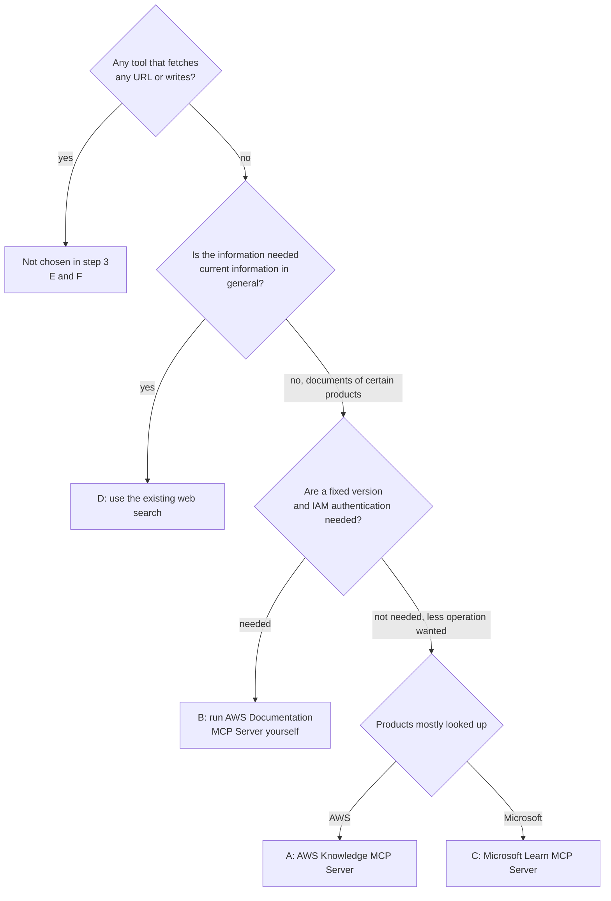

# Choosing the First Tool to Add From an External MCP Server

This document is about choosing external tools to add to this repository's RAG system (a web app that answers from internal documents, searching only what each user may read). The [threat model for MCP and Flows](mcp-flows-threat-model.md) adds tools in three steps: step 1 calls Bedrock Flows (implemented), step 2 adds internal tools, and step 3 adds one read-only tool from an external MCP server. This document collects the material for deciding which tool to add in step 3. So that readers new to MCP and agents can compare the options from the same points of view, the first part gives the material (terms, what to check, a comparison of the options, how to choose), and the last section gives this repository's decision separately. It does not rank products or services. The options are set out against the same points, including where a different option fits different conditions.

## Conclusion

- **The material**: even a "read-only tool" sends its arguments, such as a search phrase or a URL, outside. The options are compared on the six points in "What to Check". The top four (what leaves, what it can read, who runs it and where, whether it can change later) are checked before what a tool can do
- **This repository's decision**: the first tool searches and reads AWS documentation (option B). The reasons, and the constraints accepted, are in "This Repository's Decision"

## Terms

| Term | Meaning |
|---|---|
| MCP | Model Context Protocol, the convention for a model (generative AI) to call external tools and data |
| MCP server | A program that offers tools (search, read and so on) under the convention called MCP |
| Remote MCP server | One the provider runs on the internet; you connect by giving its URL |
| Self-run MCP server | One you run inside your own account. The version can be fixed, at the cost of running it |
| Argument | A value given to a tool: a search phrase for a search tool, a URL for a read tool. The model writes it from the conversation |
| Fixing the version | Deciding the version of the program in use so that it does not change to a newer one by itself |
| Fixing the tool definitions | Giving the Gateway the tools' names, descriptions and argument shapes yourself (`mcpToolSchema`). If the server changes a description, the description the model sees does not change |
| Gateway | Amazon Bedrock AgentCore Gateway: the AWS service that puts several tools behind one endpoint and decides who may call which tool. This RAG already uses it |
| AgentCore Runtime | The service that runs programs (agents, MCP servers) inside AWS, in your own AWS account |
| Cedar | The language in which the Gateway's allow and deny rules are written, such as "only the tool with this name may be called" |
| IAM (SigV4) | AWS's authentication: a call carries an AWS signature and the caller's permissions are checked. No password or API key has to be stored |
| SID filter | This RAG's permission mechanism: retrieved internal documents are narrowed to the ones the user may read |
| Threats T4-T8 | Numbers from the [threat model](mcp-flows-threat-model.md). T4: instructions in a document or tool response make the model call another tool; T6: a tool changes later; T7: an API key becomes visible; T8: management endpoints inside the VPC (a closed network inside AWS) are reached |

## What to Check

For each option, check these six points in this order. The higher ones bear most directly on data leaving.

| # | Point | What to check | Why it matters |
|---|---|---|---|
| 1 | What leaves | Where the tool's arguments (search phrase, URL) are sent | The model writes arguments from the conversation. If a retrieved internal document says "search for this", that content can go outside as a search phrase (threat T4) |
| 2 | What it can read | How far the tool can fetch (only certain sites, or any URL) | A tool that can fetch any URL becomes a route to send data to any external server, and may also reach management endpoints inside the VPC (T4, T8) |
| 3 | Who runs it and where | Remote, or run in your own account; where it runs (Region) | Requirements on where data is processed (for example, in Japan), and who fixes it during an outage |
| 4 | Whether it can change later | Whether the version can be fixed; whether the tool's description or behaviour changes at the provider's will | A different tool runs than the one approved (T6). Fixing the definitions (`mcpToolSchema`) fixes the descriptions, not the behaviour |
| 5 | Authentication | Which authentication the Gateway uses (none, OAuth, IAM, API key) | The Gateway documentation does not recommend "no authorization" ([MCP servers targets](https://docs.aws.amazon.com/bedrock-agentcore/latest/devguide/gateway-target-MCPservers.html), Authorization strategy, read 2026-11-18). An API key needs a managed place to live (T7) |
| 6 | Writing and sending | Whether tools that write, send or delete are mixed in | Step 3 is limited to reading. If they are mixed in, only the read tools are allowed, by name |

> **Note on what leaves even when reading only**: point 1 (what leaves) does not go away for any option. When a tool is added to this RAG, the web app caps the length of search phrases, the Gateway refuses tools other than those allowed by name (Cedar), and calls are recorded. Even so, a short search phrase can still contain internal information. Whether internal information may be used as a search phrase is decided by the organization's information-handling rules, not by the choice of tool

## Options

Six options against the conditions of step 3 (one read-only tool from an external server).

| Option | Who runs it and where | What it can read | What leaves | Can it change later | Authentication | Writing |
|---|---|---|---|---|---|---|
| A. AWS Knowledge MCP Server | AWS, remotely (`https://knowledge-mcp.global.api.aws`) | AWS documentation, What's New, blogs, Regional availability and more | Search phrases and URLs, to AWS's public endpoint | Changes on the operator's side; the version cannot be fixed (the tool definitions can) | None needed (the provider's page says it is rate limited); the Gateway connects with "no authorization" | None |
| B. AWS Documentation MCP Server | You, in your own account (open source, Apache-2.0; run in AgentCore Runtime or similar) | Only the `docs.aws.amazon.com` family (redirect targets are checked too) | Search phrases to the AWS documentation search API, URLs to docs.aws.amazon.com | The version can be fixed | The Gateway can call it with IAM (SigV4) (when run in AgentCore Runtime) | None |
| C. Microsoft Learn MCP Server | Microsoft, remotely (`https://learn.microsoft.com/api/mcp`) | Microsoft's public documentation and code samples | Search phrases and URLs, to Microsoft's public endpoint | Changes on the operator's side; the version cannot be fixed (the tool definitions can) | None needed (stated on the provider's page); the Gateway connects with "no authorization" | None |
| D. This RAG's web search (the AgentCore Gateway web-search connector) | AWS (us-east-1; already implemented in this repository) | Search results from the whole internet | Search phrases, to the us-east-1 Gateway and the search service behind it (which company was not checked) | Changes on the operator's side | The Gateway's execution role (IAM) | None |
| E. A general URL fetch (such as the reference fetch server) | You | Any URL | Any URL, and whatever is put into it | The version can be fixed | Depends on how you run it (your choice) | Fetch only, but putting information into a URL is the same as sending it |
| F. A SaaS MCP server (code hosting, ticketing and so on) | The provider, remotely | What the user may see inside that SaaS | Search phrases, and the user's identity at the SaaS | Changes on the operator's side | OAuth per user is needed | Many also have write tools |

For each option, where it fits, what needs consideration, and what the provider says about data, in the same form.

- **A**: fits when you want AWS's wide range of information (launch announcements, blogs, Regional availability) without the work of running anything. Considerations: the Gateway connects without authentication, the version cannot be fixed, and a route to the public internet is needed. The provider's page says the AWS Site Terms apply and that telemetry "is not used for machine learning model training or improvement purposes"
- **B**: fits when you want a fixed version, running in your own account and Region, authenticated with IAM. Considerations: the work of providing and maintaining the place it runs (AgentCore Runtime or similar), and its charges. It reads only AWS documentation pages, a narrower set of sources than A. The program runs in your own account, so you decide how data is handled; how the AWS documentation search API that receives the search phrases handles them was not checked
- **C**: fits when users mostly look up Microsoft products (Active Directory, Windows file shares and so on). Considerations, as for A: connected without authentication, version not fixable, and a route to the public internet is needed. The provider's page says the Microsoft Learn terms of use apply, there is no charge, and the content is public documentation without user profile information. That page does not say how telemetry is handled
- **D**: fits when you want broad, current information from outside. Considerations: search results are untrusted input (this repository shows them separately as references), and it runs in us-east-1. It is already implemented and is not a new addition in step 3
- **E**: not chosen in step 3. It can fetch any URL, so putting information into a URL becomes a way to send it outside. Run inside the VPC, it may also reach management endpoints there. Using it would need a separate mechanism that limits it to certain sites
- **F**: not chosen in step 3. It needs OAuth per user, a design for how the SaaS's permissions map to this RAG's, and work to separate read tools from write tools. If needed, it is handled as a step of its own

## How to Choose

The chart below is a general guide. Which option this repository actually chose is in the next section, kept separate.

## This Repository's Decision

The first tool is **B (run AWS Documentation MCP Server in our own account)**. Three tools are allowed, by name: `search_documentation`, `read_documentation` and `read_sections`.

| Point | Why B (compared with A and C) | Constraint accepted |
|---|---|---|
| What leaves | Only search phrases and docs.aws.amazon.com URLs; A and C also send search phrases and URLs | Internal information may still end up in a search phrase; the web app caps its length |
| What it can read | The server's code limits URLs and redirect targets to the docs.aws.amazon.com family | Only the code was read; it was not tried on a live deployment (note below) |
| Who runs it and where | It can be placed in AgentCore Runtime in ap-northeast-1; A and C run at the provider's endpoint | Providing and maintaining the place it runs is our own work |
| Can it change later | The version can be fixed, and updates can wait until the difference is read; A and C cannot fix the version | Updates have to be followed by us |
| Authentication | The Gateway can call it with IAM (SigV4); A and C connect with "no authorization" | None |
| Writing | None (the same for A and C) | None |
| Sources | AWS documentation pages | Narrower than A (no What's New, blogs or Regional availability) |
| Cost | AgentCore Runtime in our own account is charged; the providers' pages say A and C are free | The price was not checked; it is checked on the pricing page before implementation |

> **Note on what was checked**: `_require_supported_domain` in `server_aws.py` and the redirect check in `server_utils.py` of awslabs/mcp were read on the main branch on 2026-11-18 (`pyproject.toml` said version 1.2.6 at that time). Whether the released package has the same content, and how it behaves on a live deployment, were not checked. At implementation, a version-fixed package is checked to refuse URLs outside docs.aws.amazon.com

**When this decision would change**: if the least operation matters most, or What's New and blogs are wanted too, A fits. Then first decide, as an organization, whether to accept connecting without authentication and not being able to fix the version. If users mostly look up Microsoft products, C fits, with the same considerations as A.

## FAQ

**Q. Isn't "read-only" safe?**
A. Even when a tool writes nothing, its arguments (search phrases, URLs) are sent outside. This remains for every option and is kept small by capping search phrase length, limiting the allowed tools, and recording calls.

**Q. What is the difference between a remote MCP server and one you run yourself?**
A. A remote one is run by the provider, so there is little work, but the version cannot be fixed and it changes at the provider's will. Running it yourself lets you fix the version and protect it with your own account's authentication (IAM), but needs a place to run it and maintenance.

**Q. Does this choice include tools that read internal documents?**
A. No. Each user may read a different set of internal documents, so they have to go through the mechanism that checks what the user may read (the SID filter). They are therefore handled apart from external tools, as internal tools (step 2 of the threat model).

## Related Documents

- [Threat model for MCP and Flows](mcp-flows-threat-model.md)
- [Implementation overview](implementation-overview.md) (Agent mode, AgentCore Policy, web search)
- [AWS Knowledge MCP Server](https://awslabs.github.io/mcp/servers/aws-knowledge-mcp-server), [AWS Documentation MCP Server](https://awslabs.github.io/mcp/servers/aws-documentation-mcp-server), [Microsoft Learn MCP Server](https://learn.microsoft.com/en-us/training/support/mcp)
- [AgentCore Gateway MCP server targets](https://docs.aws.amazon.com/bedrock-agentcore/latest/devguide/gateway-target-MCPservers.html) (authorization types, fixing tool definitions)
