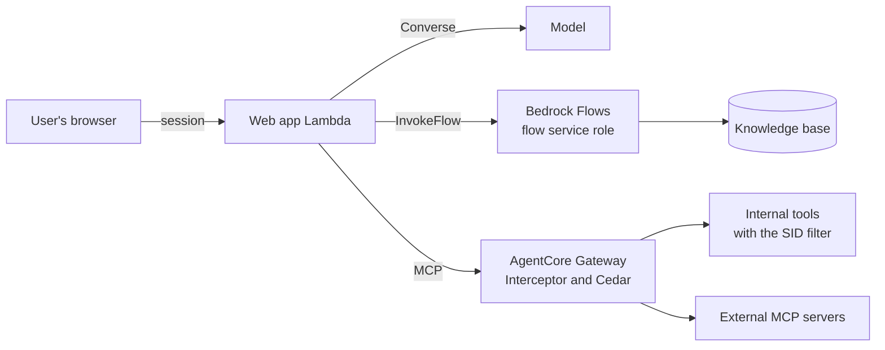

# Threat Model Before Adding MCP Tools and Bedrock Flows

This document lists the threats of adding features like GenU's "MCP chat" and "Flow chat" to this permission-aware RAG, and the design decisions that address them. It comes before the implementation: only what meets the constraints decided here is built.

## Conclusion

- **A Bedrock Flows knowledge base node cannot be narrowed to the calling user's permissions.** A flow runs with its own service role, and the node configuration has no per-user filter. Opening a flow with a knowledge base node to users would give users documents of that KB that they may not read. So only flows an administrator registered are called, and before each call the flow definition is read, and a flow containing nodes that read internal data or write outside is refused
- **MCP tools do not run inside the web app's Lambda.** GenU has also deprecated its MCP chat, which runs `uvx` / `npx` MCP servers inside a Lambda, in favour of AgentCore. This RAG's Agent mode already goes through AgentCore Gateway and the permission Interceptor, so MCP tools are added as targets of that Gateway, where per-tool permissions (Cedar) and the user's identity are handled
- **A tool that reads internal documents only returns what passed the same SID filter as KB mode.** The permission boundary stays in one place, the SID filter; tools and flows do not get boundaries of their own

## Terms

| Term | Meaning in this document |
|---|---|
| MCP | Model Context Protocol, the convention for a model to call external tools and data |
| MCP server | A program that offers tools over MCP; often a third-party product or open source |
| AgentCore Gateway | The AWS service that puts several tools behind one MCP endpoint; this RAG's Agent mode uses it |
| Bedrock Flows | The Bedrock feature that defines and runs a sequence of connected nodes (prompts, knowledge bases, Lambda and others) |
| SID filter | This RAG's permission boundary: retrieved documents are narrowed by matching the user's SIDs with the SIDs in the document metadata (`sid-filter.ts`) |

## What Is Protected and the Trust Boundaries

Four things are protected: internal documents whose readers are set by SID, the user's identity (whose permissions an action runs with), the permissions of the web app's role, and the usage charges.

There are three boundaries: user to web app (the session establishes who the user is), web app to flow (a flow runs with the flow's role, not the user's), and web app to the tools behind the Gateway (a tool runs with the tool's execution role, not the user's). At the last two, the user's permissions are not carried over by themselves.

## Threats

| # | Threat | Where | Impact |
|---|---|---|---|
| T1 | A flow's knowledge base node returns documents without narrowing by the user's SIDs | Flows | Documents the user may not read reach the answer (the permission boundary is bypassed) |
| T2 | A flow's agent, S3 retrieval or Lambda node reads internal data with the flow's role | Flows | Same as T1 |
| T3 | A flow's S3 storage or Lambda node writes the user's input or the answer somewhere outside | Flows | Data stays in places the user did not intend |
| T4 | Instructions written in a retrieved document or a tool response make the model call another tool (indirect prompt injection) | MCP | Content of documents the user may read is sent to an external tool |
| T5 | A tool runs with the web app's role and reads with permissions the user does not have (confused deputy) | MCP | Documents the user may not read, or other users' data, are returned |
| T6 | An external MCP server changes a tool's description or behaviour later; `npx` / `uvx` fetch the latest version at every start | MCP | A different tool runs than the one approved (a supply-chain problem) |
| T7 | An MCP server's API key is put in the Lambda environment | MCP | Anyone who can read the Lambda configuration sees the key |
| T8 | A tool running inside the VPC reaches management endpoints in the VPC (such as the FSx for ONTAP management IP) | MCP | Internal management planes are reached from an external tool |
| T9 | Tool calls keep going without a stop | MCP / Flows | Charges and time grow |
| T10 | Nothing records who called which tool or flow with what input | Both | An incident cannot be traced afterwards |

> **Note on the flow knowledge base node**: the node configuration has `knowledgeBaseId`, `modelId` and `guardrailConfiguration` ([Node types for your flow](https://docs.aws.amazon.com/bedrock/latest/userguide/flows-nodes.html)). In the SDK (`@aws-sdk/client-bedrock-agent` 3.1164.0), `KnowledgeBaseFlowNodeConfiguration` adds the number of results, a prompt template, inference settings, reranking and orchestration settings, and no retrieval filter. A flow's service role needs permission for each KB its nodes query ([Service role for Amazon Bedrock Flows](https://docs.aws.amazon.com/bedrock/latest/userguide/flows-permissions.html)). From these two, there is judged to be no way to narrow by the calling user (documented; not checked on a live deployment)

> **Note on GenU's MCP chat**: GenU's deploy options document marks MCP chat as deprecated and points to its AgentCore use case for MCP. It lists these constraints: MCP servers run inside a Lambda with `uvx` or `npx`, stdio only, and API keys are written in the `env` of `mcp.json` ([GenU DEPLOY_OPTION](https://github.com/aws-samples/generative-ai-use-cases/blob/main/docs/en/DEPLOY_OPTION.md))

## Design Decisions

### Flows

| Decision | Threats addressed |
|---|---|
| Only flows an administrator registered in CDK context (`flowId` and `aliasId`) can be called | T1-T3 |
| Before each call, read the definition of the flow version the alias points to and check that it consists only of allowed node types (input, output, prompt, condition, iterator, collector, DoWhile loop). A flow containing anything else (knowledge base, agent, S3 retrieval, S3 storage, Lambda, inline code, Lex) is refused without being called | T1-T3 |
| The version is read from the alias every time. If the alias is pointed elsewhere, a version that fails the check is not called | T1-T3, T6 |
| Work that needs internal documents uses KB mode (the SID filter), not a flow | T1, T2 |
| The user, flow, version, and the allow or refuse result go to a structured log; the input text does not | T10 |

> **Note on the gap between check and call**: `InvokeFlow` is called with an alias and cannot name a version. If the alias is pointed elsewhere between the check and the call, an unchecked version runs. The gap is two API calls long, and only people with Bedrock management permissions can change an alias. This gap is treated as a remaining risk, kept small by limiting who can change aliases to administrators

> **Note on the inline code node**: what the inline code node's runtime can reach (network, AWS APIs) was not checked (hypothesis). It is not an allowed node type until it is shown not to reach them

### MCP

| Decision | Threats addressed |
|---|---|
| MCP servers do not run inside the web app's Lambda; they are added as targets of the Agent-mode AgentCore Gateway | T5, T7, T8 |
| Only tools on an allow list by name (Cedar `permit`) can be called. The "read-only" annotation an MCP server attaches is the server's own claim and is not a basis for the decision | T4, T6 |
| Tools that can send data out (writing, sending, fetching an arbitrary URL) are not allowed by default | T4 |
| A tool that reads internal documents goes through the SID filter, like the existing `permission-search`. As in Agent mode, the web app takes the user from the session and passes it; the model cannot name the user in an argument | T5 |
| Credentials for external MCP servers are kept in Secrets Manager or AgentCore Identity, not in the Lambda environment | T7 |
| Tool calls have a per-question limit | T9 |
| The Gateway policy runs in `LOG_ONLY` until its behaviour is checked, then `ENFORCE` (the same caution as the Cedar note in AGENTS.md) | T4, T6 |

## Step-by-Step Introduction

1. **Flows**: an API and screen that call flows made only of allowed nodes. The refusal is checked by unit tests, allow and refuse on a live deployment (implemented; results in [evaluation](evaluation.md) 3.17)
2. **MCP (internal tools)**: any internal tool added to the Gateway besides the existing `permission-search` also follows the decisions in this document
3. **MCP (external servers)**: add one read-only tool, allowed by name. Tools that send data out are not added at this step

## FAQ

**Q. Can a metadata filter in the flow's knowledge base node narrow results by user?**
A. The node configuration has no retrieval filter, and even if it had one, the value would be fixed in the flow definition and could not change per calling user. Handle internal documents in KB mode.

**Q. If an MCP server declares a tool "read-only", can it be allowed?**
A. The declaration is written by the server itself and can change later. Allowing is done by tool name, after an administrator has checked what the tool does.

**Q. Are Agent mode and MCP chat separate features?**
A. Not in this RAG. The way Agent mode calls tools through AgentCore Gateway is itself the way MCP tools are called.

## Next Steps

Following the decisions in this document, the flow call (step 1) is implemented first. External MCP servers (step 3) start once the tool to add is decided.

## Related Documents

- [Implementation overview](implementation-overview.md) (SID filter, Agent mode, AgentCore Policy)
- [Stage-2 design](genu-stage2-design.md)
- [Authentication and user management guide](auth-and-user-management.md) (the administrator role)
