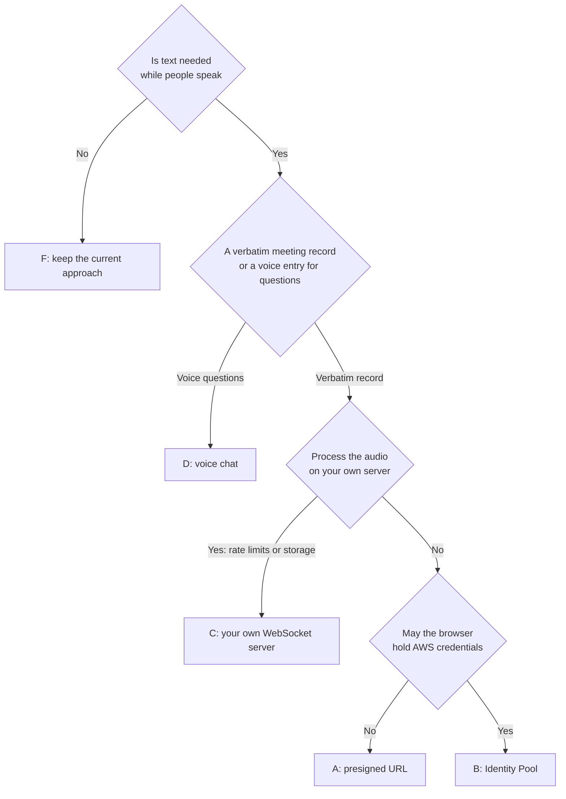

# Options for Real-Time Transcription
**🌐 Language:** [日本語](../realtime-transcription-options.md) | **English**

This document lists the options for adding speech-to-text while people are still talking to this repository's RAG app (a web app that answers from internal documents, searching only what each user may read). **Nothing is implemented.** The existing minutes feature uploads a recording to S3 and runs an Amazon Transcribe batch job ([second-stage design](genu-stage2-design.md)); there is no transcription while people speak. This document sets out the options and the facts needed to choose. This repository has not chosen one.

## Conclusion
- The options that transcribe Japanese inside AWS are Amazon Transcribe streaming (A, B, C) and Amazon Nova Sonic (D). Nova Sonic is a speech model for conversing with, already used by the voice chat; it is not meant for verbatim records such as minutes
- A, B and C differ in how the browser authenticates to Transcribe and whether you run your own compute in between. The audio sent to Transcribe and the text returned are the same
- A comment in the voice chat code says the web app's Next.js route (on Lambda) cannot accept a WebSocket upgrade (not re-checked this time). So only C, where a server receives the audio, needs new compute that accepts WebSockets
- Under every option the transcript is the user's own input, not a document in the RAG index. The SID filter (which limits results to documents the user may read) applies at the later step where the transcript is used to search

## Terms
| Term | Meaning |
|---|---|
| Streaming | Sending audio in small pieces and receiving text continuously. The existing minutes feature is batch (the whole recording is stored first, then processed once) |
| Presigned URL | A URL with an AWS signature embedded that allows a connection for a limited time. Transcribe's WebSocket starts from a presigned URL |
| Cognito Identity Pool | Gives a signed-in user short-lived AWS credentials usable in the browser. A separate resource from the User Pool (sign-in) |
| Speaker partitioning | Labeling each speaker. Available in streaming too |
| Nova Sonic | An Amazon model that takes speech and returns speech and text, used over a bidirectional stream |

## What to check
Each option is checked on the same five points, in this order.
1. Where the audio and text go
2. What the browser authenticates with
3. What you run in between
4. Length and concurrency limits
5. Cost

## Options
| ID | Approach | Where the audio goes | Browser authentication | What you run in between |
|---|---|---|---|---|
| A | Browser connects straight to Transcribe over WebSocket; the web app signs the URL | Transcribe in your account (Tokyo) | A presigned URL the web app creates (valid for 5 minutes to start the connection) | Nothing (add one API that creates the signature) |
| B | Browser connects straight to Transcribe and signs with Identity Pool credentials | Same | Short-lived Identity Pool credentials | Add an Identity Pool and an IAM role |
| C | Browser → your WebSocket server → Transcribe (HTTP/2) | Same (through your server) | Authentication to your WebSocket server (SigV4 or OAuth, for example) | Compute that accepts WebSockets (AgentCore Runtime, API Gateway WebSocket, and so on) |
| D | Nova Sonic bidirectional stream (the current voice chat mechanism) | Bedrock in the same account (Tokyo) | The web app's existing authentication | Nothing added (voice chat is implemented) |
| E | The browser's built-in speech recognition (Web Speech API) | Depends on the browser vendor | None | Nothing |
| F | Keep the current approach (batch processing of a recording) | Transcribe and S3 in your account | The web app's existing authentication | Nothing |

### Common facts (Transcribe streaming, A, B, C)
- **[documented]** Tokyo (ap-northeast-1) has a streaming endpoint ([endpoints and quotas](https://docs.aws.amazon.com/general/latest/gr/transcribe.html))
- **[documented]** Japanese was announced as a streaming language ([announcement](https://aws.amazon.com/blogs/machine-learning/amazon-transcribe-streaming-adds-support-for-japanese-korean-and-brazilian-portuguese/)). The `ja-JP` row of the current language table was not checked
- **[documented]** Speaker partitioning works in streaming and fits two to five speakers best; accuracy drops beyond five ([blog](https://aws.amazon.com/blogs/machine-learning/using-speaker-diarization-for-streaming-transcription-with-amazon-transcribe-and-amazon-transcribe-medical/))
- **[documented]** Audio formats are PCM (signed 16-bit little-endian, not WAV), FLAC and OPUS in Ogg; 16,000 Hz is recommended. One stream per connection ([streaming](https://docs.aws.amazon.com/transcribe/latest/dg/streaming.html))
- **[documented]** The default is 25 concurrent streams (adjustable), and one connection can stay open up to 8 hours ([quotas](https://docs.aws.amazon.com/general/latest/gr/transcribe.html), [FAQ](https://aws.amazon.com/transcribe/faqs/))
- **[documented]** Standard streaming costs 0.0001667 USD per second in ap-northeast-1 (0.01 USD per minute, 0.60 USD per hour). Read from the AWS Price List API on 2026-11-19
- **[documented]** Audio processed by Transcribe may be used to provide and improve the service. An AWS Organizations opt-out policy stops this ([FAQ](https://aws.amazon.com/transcribe/faqs/)). For internal meetings, decide the policy before use

### A: the browser connects with a URL the web app signs
- **[documented]** The maximum `X-Amz-Expires` for a WebSocket presigned URL is 300 seconds (5 minutes). This is the time allowed to start the connection; the length after connecting is bounded by the 8 hours above ([WebSocket stream](https://docs.aws.amazon.com/transcribe/latest/dg/streaming-setting-up.html))
- The signature uses the web app Lambda's role, so that role needs `transcribe:StartStreamTranscriptionWebSocket`. **Anyone who can obtain a URL can use Transcribe**, so the signing API requires sign-in, limits the rate, and fixes the language and format
- No new resource. The work is one signing API and, in the browser, converting audio to PCM (microphone input, conversion to 16 kHz, sending every 100 to 200 ms)

### B: the browser signs with Identity Pool credentials
- The SDK works in the browser as is, but you add an Identity Pool and an IAM role that signed-in users assume. While the credentials are valid, the browser can do anything the role allows, so limit the role to `transcribe:StartStreamTranscriptionWebSocket`
- This repository has no Identity Pool (no `IdentityPool` text under `lib/`). Adding one adds a second user-authentication mechanism

### C: your own WebSocket server receives the audio
- Audio passes through your server, so you can add steps before and after the text is produced (per-user rate limits, storing the text, naming speakers). The server sends to Transcribe over HTTP/2
- **[documented]** AgentCore Runtime accepts WebSocket at `/ws`, with a SigV4 presigned URL or OAuth 2.0 ([WebSocket getting started](https://docs.aws.amazon.com/bedrock-agentcore/latest/devguide/runtime-get-started-websocket.html)). This repository's agents already run on AgentCore Runtime
- You take on operating the compute and designing the authentication for the connection. More to add than A

### D: Nova Sonic
- Tokyo has `amazon.nova-2-sonic-v1:0` and `amazon.nova-2-5-sonic` (2026-11-19, `aws bedrock list-foundation-models`). **Japanese support was not checked this time**
- Its use is conversation: speak and get an answer. It is not aimed at verbatim meeting records or speaker partitioning. The repository's document gives the current voice chat connection limit as 8 minutes (not re-checked)
- If transcription is the goal there is little reason to choose it. If the goal is a "ask by voice" entry point rather than a meeting record, it already exists

### E: the browser's built-in recognition
- It runs outside AWS, and where the audio is processed depends on the browser vendor and the user's environment. Not checked. For internal talk, not being able to confirm the destination is the main concern
- Supported browsers and Japanese accuracy also vary by environment

### F: keep the current approach
- It processes after the recording ends, so no text appears while people speak. Nothing to add, and already checked in ap-northeast-1 ([evaluation](evaluation.md) 3.9)

## How to choose

E is not in the chart because it is processed outside AWS.

## What to decide before choosing
- Whether the organization accepts Transcribe using meeting audio to improve the service (whether an opt-out policy is needed)
- How many people use it at once. If it exceeds the default of 25, request an increase in Service Quotas
- Whether to store the transcript. If so, who may read it (the speaker only, or the meeting's participants) and for how long
- Whether speaker names are needed (Transcribe's partitioning gives labels such as "speaker 0" and "speaker 1", not names)

## FAQ
**Q. Does this replace the current minutes feature?**
A. No. Real-time is an addition for when text is wanted without waiting for the recording. At the end of the meeting, the text can be passed to the existing minutes formatting (Bedrock).

**Q. Is the Japanese accuracy good enough?**
A. Streaming Japanese was not measured in this repository. Batch `ja-JP` transcribed one sentence almost verbatim ([second-stage design](genu-stage2-design.md)). Measure with real meeting audio before implementing.

**Q. How large is the delay?**
A. Not measured. The official guidance says sending audio in 50 to 200 ms chunks keeps latency low ([streaming](https://docs.aws.amazon.com/transcribe/latest/dg/streaming.html)).

## Related Documents
- [Second-stage design](genu-stage2-design.md) (minutes)
- [Implementation overview](implementation-overview.md)
- [Amazon Transcribe streaming](https://docs.aws.amazon.com/transcribe/latest/dg/streaming.html)
- [AgentCore Runtime WebSocket](https://docs.aws.amazon.com/bedrock-agentcore/latest/devguide/runtime-get-started-websocket.html)
