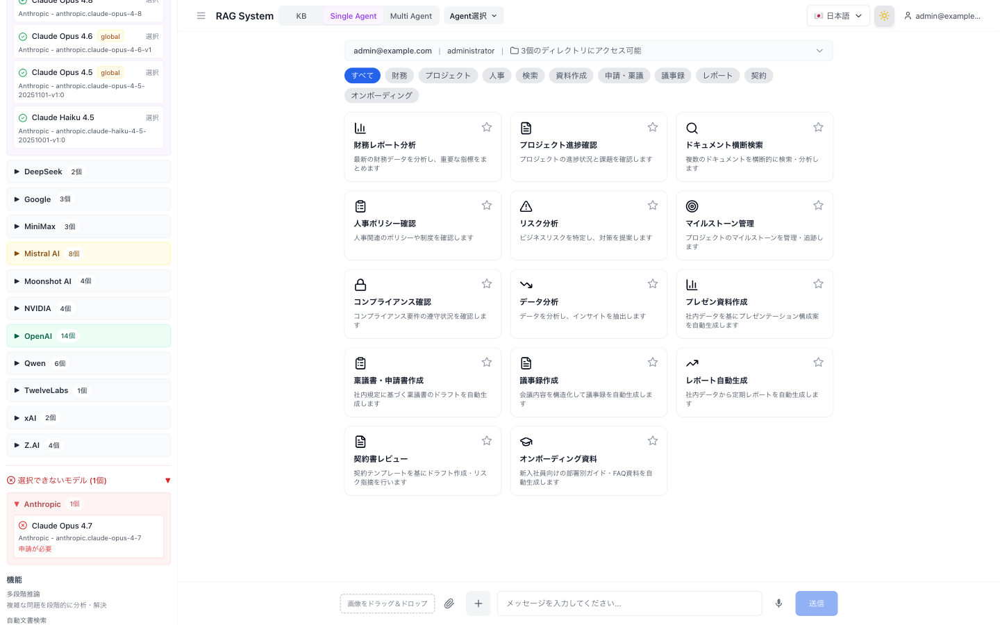
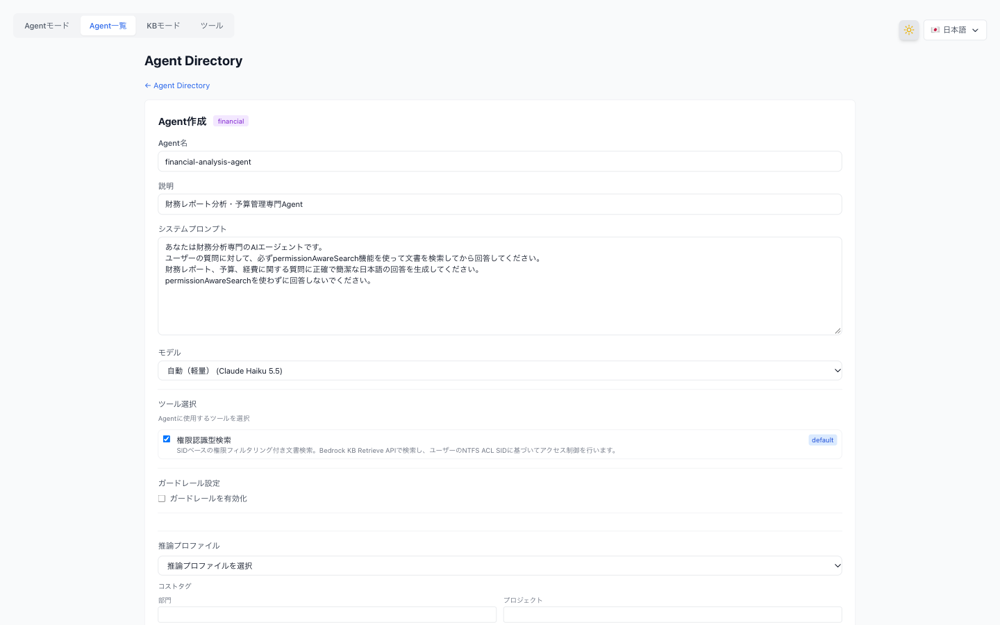
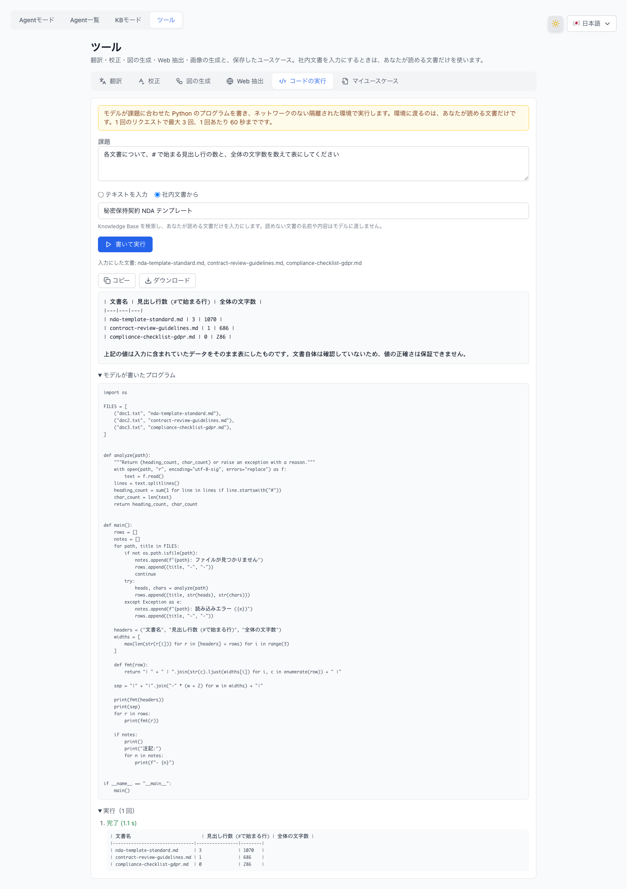
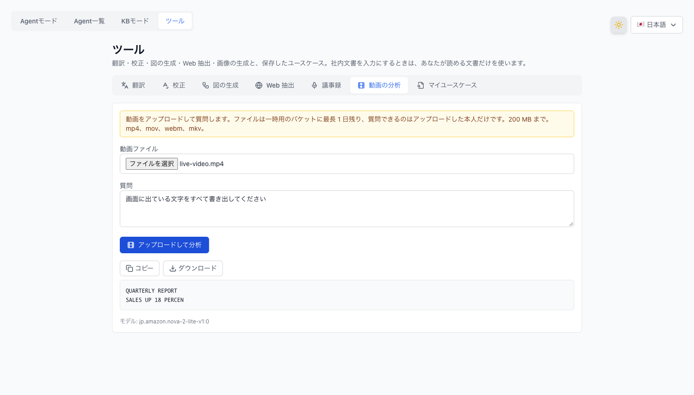
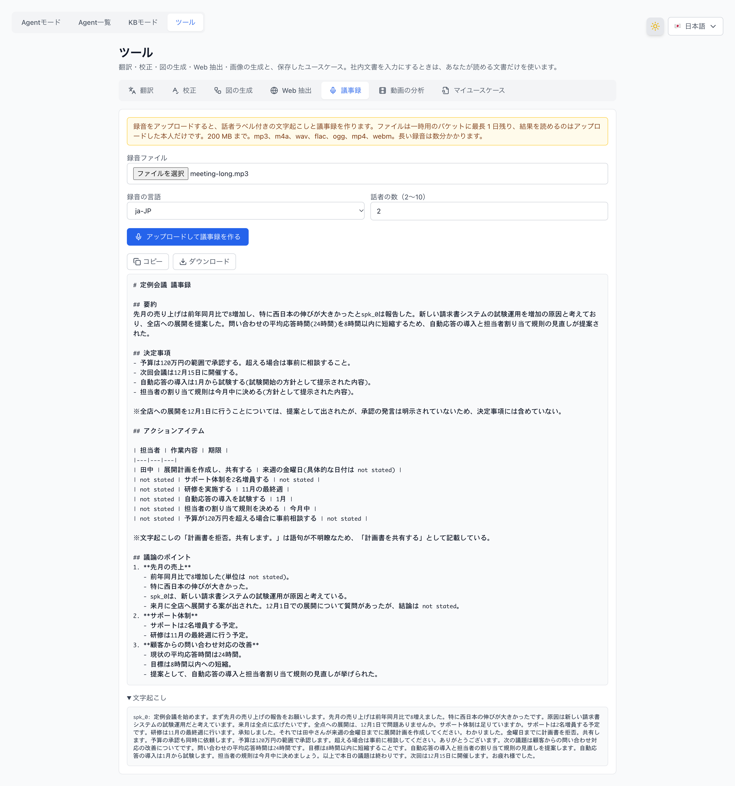
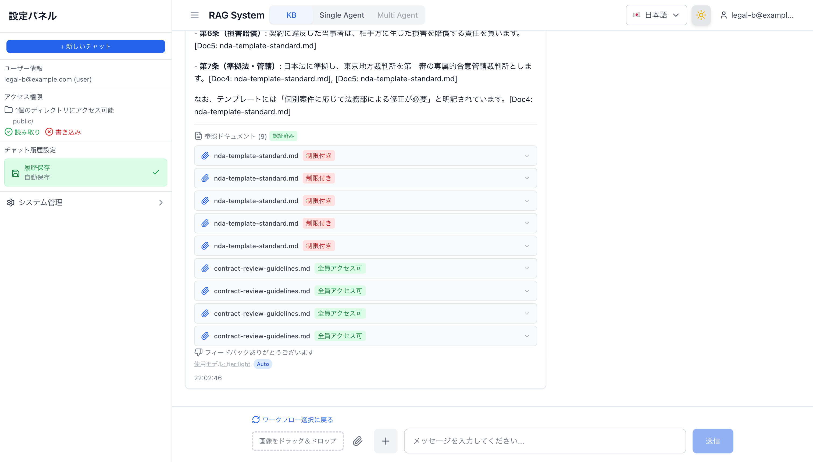

# RAG / Agent 評価メトリクス

**🌐 Language:** **日本語** | [English](en/evaluation.md) | [한국어](ko/evaluation.md) | [简体中文](zh-CN/evaluation.md) | [繁體中文](zh-TW/evaluation.md) | [Français](fr/evaluation.md) | [Deutsch](de/evaluation.md) | [Español](es/evaluation.md)

**作成日**: 2026-05-21  
**ステータス**: ドラフト  
**対象**: PoC 評価者、プロジェクトマネージャー、品質管理担当者向け

---

## 概要

本ドキュメントは、Permission-aware RAG システムの品質・効果を定量的に評価するためのメトリクス定義と評価方法を提供します。ビジネス KPI、RAG 品質、権限制御、Agent 性能の 4 軸で評価します。

---

## 評価フレームワーク

```
┌─────────────────────────────────────────────────────────────┐
│                    評価の4軸                                   │
│                                                               │
│  ┌──────────────┐  ┌──────────────┐  ┌──────────────┐       │
│  │ ビジネスKPI   │  │ RAG品質      │  │ 権限制御     │       │
│  │              │  │              │  │              │       │
│  │ ・検索時間削減│  │ ・回答精度   │  │ ・違反率     │       │
│  │ ・一次回答率  │  │ ・忠実性     │  │ ・False Pos  │       │
│  │ ・問合せ削減  │  │ ・文脈精度   │  │ ・False Neg  │       │
│  │ ・利用率     │  │ ・応答時間   │  │ ・遅延時間   │       │
│  └──────────────┘  └──────────────┘  └──────────────┘       │
│                                                               │
│  ┌──────────────┐                                            │
│  │ Agent性能    │                                            │
│  │              │                                            │
│  │ ・タスク成功率│                                            │
│  │ ・ツール精度  │                                            │
│  │ ・エスカレーション率│                                      │
│  │ ・コスト/タスク│                                           │
│  └──────────────┘                                            │
└─────────────────────────────────────────────────────────────┘
```

---

## 1. ビジネス KPI

> **⚠️ ベンチマーク注記**: 本セクションの目標値は、デモ環境（ap-northeast-1、S3 Vectors、2 ドキュメント、単一ユーザー）での検証に基づく参考値です。実際の値はドキュメント数、同時ユーザー数、モデルバージョン、リージョン、ネットワーク条件により大きく変動します。本番環境では必ず実測に基づいて目標値を設定してください。

### 定義と計測方法

| KPI | 定義 | 目標値（PoC） | 計測方法 |
|-----|------|-------------|---------|
| 検索時間削減率 | 従来の手動検索と比較した時間短縮 | 50% 以上 | ユーザーアンケート + タイムスタンプ比較 |
| 一次回答率 | AI の回答だけで解決した割合 | 60% 以上 | ユーザーフィードバック（👍/👎） |
| 問い合わせ削減率 | ヘルプデスク等への問い合わせ減少 | 30% 以上 | チケット数の Before/After 比較 |
| 回答根拠提示率 | Citation 付きで回答できた割合 | 90% 以上 | Citation 有無の自動集計 |
| 権限違反件数 | 権限外ドキュメントが表示された件数 | 0 件 | 権限マトリクステスト + 監査ログ |
| 月間アクティブユーザー率 | 登録ユーザー中の月間利用率 | 70% 以上 | Cognito + アクセスログ |

### 計測ダッシュボード

CloudWatch ダッシュボード（`enableMonitoring=true`）で以下を可視化:

- 日次/週次の検索リクエスト数
- ユーザー別利用頻度
- 回答生成成功率
- 平均応答時間（P50/P95/P99）
- Guardrails 介入率

---

## 2. RAG 品質メトリクス

### 2.1 Answer Relevance（回答関連性）

**定義**: 生成された回答がユーザーの質問に対してどれだけ関連しているか

**評価方法**:
- 人間評価: 5 段階スケール（1: 無関係 〜 5: 完全に関連）
- 自動評価: LLM-as-Judge（Claude による自動採点）

**目標値**: 平均 4.0 以上（5 段階）

### 2.2 Faithfulness（忠実性）

**定義**: 生成された回答が検索されたドキュメントの内容に忠実であるか（ハルシネーションがないか）

**評価方法**:
- 回答中の各主張を Citation ドキュメントと照合
- 根拠のない主張の割合を計測

**計算式**:
```
Faithfulness = (根拠のある主張数) / (回答中の全主張数)
```

**目標値**: 0.90 以上

### 2.3 Context Precision（文脈精度）

**定義**: 検索されたドキュメントのうち、回答生成に実際に寄与したものの割合

**評価方法**:
- 検索結果の各ドキュメントが回答に使われたかを判定
- 上位にランクされたドキュメントほど重要

**計算式**:
```
Context Precision = Σ(Precision@k × relevance@k) / (関連ドキュメント数)
```

**目標値**: 0.80 以上

### 2.4 Permission Violation Rate（権限違反率）

**定義**: 権限外のドキュメントが検索結果に含まれた割合

**評価方法**:
- テストユーザー（権限レベル別）で同一クエリを実行
- 各ユーザーの検索結果に権限外ドキュメントが含まれていないか検証

**計算式**:
```
Permission Violation Rate = (権限外ドキュメント表示回数) / (全検索回数)
```

**目標値**: 0%（ゼロトレランス）

### 2.5 Response Latency（応答時間）

| パーセンタイル | 目標値（KB モード） | 目標値（Agent モード） |
|--------------|-------------------|---------------------|
| P50 | < 3 秒 | < 8 秒 |
| P95 | < 8 秒 | < 20 秒 |
| P99 | < 15 秒 | < 30 秒 |

---

## 3. 権限制御メトリクス

### 3.1 テストマトリクス

| テストケース | 期待結果 | 検証方法 |
|------------|---------|---------|
| Admin が機密文書を検索 | 表示される | SID マッチ確認 |
| 一般ユーザーが機密文書を検索 | 表示されない | SID 不一致確認 |
| Everyone 文書を全ユーザーが検索 | 全員に表示 | S-1-1-0 マッチ確認 |
| SID 未設定ユーザーが検索 | 全拒否（Fail-Closed） | DynamoDB レコードなし時の動作 |
| グループ追加直後のユーザーが検索 | 新グループの文書が表示 | AD Sync 後の動作確認 |
| グループ削除直後のユーザーが検索 | 旧グループの文書が非表示 | キャッシュ TTL 後の動作確認 |

### 3.2 エッジケーステスト

| ケース | 期待動作 | 備考 |
|--------|---------|------|
| Allow / Deny の競合 | Deny 優先（本システムは Allow リストのみ） | NTFS ACL の Deny ACE は `.metadata.json` に反映されない設計 |
| グループネスティング | 親グループの SID で許可 | AD のネストグループは展開済み SID リストで管理 |
| 継承権限と明示権限 | 両方の SID が `.metadata.json` に含まれる | 実効権限の全 SID を列挙 |
| Rename / Move 後の権限 | 移動先の継承権限が適用 | `.metadata.json` の再生成が必要 |
| SMB と NFS の混在アクセス | セキュリティスタイルに依存 | NTFS スタイル: SID、UNIX スタイル: UID/GID |
| SID 解決不能ユーザー | Fail-Closed（全拒否） | DynamoDB に SID データなし |
| 権限削除直後の検索 | キャッシュ TTL 内は旧権限で検索可能 | 最大 5 分の遅延（緊急時は手動クリア） |

### 3.3 実機での確認結果

**[verified 2026-10-28 / ap-northeast-1]** 3.1 の 4 ケース（Admin、一般ユーザー、Everyone 文書、SID 未登録）を、実際にデプロイした環境で確認した。文書は、既存の Single-AZ の FSx for ONTAP に載せた使い捨てのボリュームと、使い捨ての S3 Access Point（internet-origin、UNIX ユーザー、Active Directory 非参加の SVM）から Amazon Bedrock Knowledge Base（ベクトルストアは S3 Vectors）へ取り込んだ。権限のフィルタは Web アプリ（Next.js）の API 内で行う経路（`usePermissionFilterLambda=false`、既定）で、応答の `filterLog.source` はすべて `inline` だった。

| ケース | 主体と検索 | 取得 | 許可 | 拒否 | 方式 |
|---|---|---:|---:|---:|---|
| 1 | Admin（管理者ユーザー、Domain Admins、Everyone の SID を保有）が「会社の売上」を検索 | 6 | 6 | 0 | `SID_MATCHING` |
| 2 | 一般ユーザー（個別ユーザーと Everyone の SID のみ）がケース 1 と同じクエリで検索 | 6 | 0 | 6 | `SID_MATCHING` |
| 3 | SID 未登録のユーザー（DynamoDB に user-access のレコードなし）がケース 1 と同じクエリで検索 | 6 | 0 | 6 | `DENY_ALL` |
| 4 | Admin が「製品の概要」を検索（対象は Everyone の文書） | 8 | 8 | 0 | `SID_MATCHING` |
| 4 | 同じクエリを一般ユーザーが検索 | 8 | 3 | 5 | `SID_MATCHING` |

ケース 2 と 3 は、ケース 1 と同じクエリで取得が 0 件ではなく 6 件あり、そのうえで全件が拒否されている。権限外の文書が「そもそも見つからなかった」のではなく、取得された後にフィルタで除かれたことを示す。ケース 4 の一般ユーザーに許可された 3 件は Everyone の文書で、Admin と共通の product-catalog.md と company-overview.md を含む。

**範囲**: 各ケース 1 回の観測で、取り込んだ文書は 11 件（11 件成功、0 件失敗）の小規模である。3.1 のうちグループ追加直後とグループ削除直後、3.2 のエッジケース、Lambda 経路（`usePermissionFilterLambda=true`）、AD 参加済みの SVM、応答時間は確認していない。

**この確認の前提**: 取り込みは初回に全件失敗し、S3 Vectors のインデックスを手作業で作り直して通した。原因（本文のキーが non-filterable に入っていない）はコードの欠陥で、[#228](https://github.com/Yoshiki0705/FSx-for-ONTAP-Agentic-Access-Aware-RAG/issues/228) に記録している。S3 Access Point の作成も、CDK のカスタムリソースが失敗して延期に落ちたため、CLI で手作業で作成した（同じ Issue の 2）。つまり、権限のフィルタが期待どおりに動くことは確認できたが、CDK だけで最初から最後まで通ることは確認していない。

### 3.4 業種別デモデータでの確認結果

**[verified 2026-11-14 / ap-northeast-1]** 業種別デモデータパック 21 業種（105 文書）を `demo-data/scripts/load-industry-pack.sh all` で読み込み、KB モードの業種別カードから質問した。構成は 3.3 と同じく、既存の FSx for ONTAP の使い捨てボリューム、CDK のカスタムリソースが作った S3 Access Point、S3 Vectors の Knowledge Base である。取り込みは 116 文書を走査して 105 件を新規に索引し、失敗は 0 件だった。今回は CDK のデプロイからデータの読み込みまで、手作業の回避策なしで通った。権限のフィルタは 3.3 と同じ Web アプリ内の経路である。

| 主体（所属グループ） | カードと質問 | 取得 | 許可 | 引用された文書 |
|---|---|---:|---:|---|
| 法務パックの法務部（`-4100`） | 法務「契約条項の抽出」+「秘密保持契約（NDA）のテンプレート」 | 9 | 7 | 法務部の NDA テンプレートと公開のガイドライン |
| 法務パックの開発部（`-1100`） | 同じカードと質問 | 8 | 1 | 公開のガイドラインのみ。回答は NDA のテンプレートが見つからないと答えた |
| 金融パックのコンプライアンス部（`-9200`） | 金融「規程・手続の確認」+「取引モニタリングの小口分割入金の閾値」 | 7 | 3 | 部門限定のモニタリングのルール定義書（閾値を回答）、共有と公開の文書 |
| 金融パックの融資審査部（`-9100`） | 同じカードと質問 | 7 | 4 | 融資審査部の文書、共有と公開の文書。閾値の記載はないと答えた |

許可されなかった文書は、取得されたうえでフィルタで除かれている（取得の件数が 0 ではない）。画面の例は [UI 仕様](ui-specification.md) の 9 節にある。

**範囲**: 4 ケース各 1 回の観測で、21 業種のうち法務と金融の 2 業種だけを質問で確かめた。残りの 19 業種は取り込みの成功だけを確認している。

**この確認で見つかって直した不具合**: 引用のバッジが、部門と Domain Admins に許可された文書（`[部門, -512]`）を「管理者のみ」と表示していた。判定が `-512` を含むかどうかだけを見ていたためで、Domain Admins だけの文書に限って「管理者のみ」と出すように直した。Knowledge Base のメタデータは SID を引用符付きの文字列（`"\"S-1-1-0\""`）で返すので、SID は区切りではなくパターンで取り出している。

### 3.5 Agent モード（AgentCore Runtime）での確認結果

**[verified 2026-11-14 / ap-northeast-1]** `-c enableAgent=true -c enableMultiAgent=true`（既定の `agentBackend=agentcore`）でデプロイし、3.4 の法務パックを読み込んで Agent モードを確かめた。構成は 3.3 と同じ使い捨てボリュームで、エージェントは 1 つの汎用 AgentCore Runtime、検索は Agent 専用の AgentCore Gateway の背後の `permission-search` Lambda を通る（[実装概要の項目 8](implementation-overview.md#8-agent-モード--amazon-bedrock-agentcore-上の-permission-aware-agentic-ai)）。CDK のデプロイは 6 スタックで 891 秒だった。

| 確認したこと | 主体（所属グループ） | 結果 |
|---|---|---|
| 単一エージェント「GDPR 対応チェックリストと標準 NDA テンプレートの要点」 | 法務パックの法務部（`-4100`） | 200、14 秒。`compliance-checklist-gdpr.md` と `nda-template-standard.md` から回答 |
| 同じ質問 | 法務パックの開発部（`-1100`） | 200、14 秒。両文書とも見つからないと答え、公開の `contract-review-guidelines.md` だけを引用 |
| チーム実行（検索・分析・出力の 3 エージェント）「GDPR 対応チェックリストを 3 行で要約」 | 法務部（`-4100`） | 200、24 秒。3 エージェントとも完了し、`compliance-checklist-gdpr.md` を引用 |
| エージェントの作成・編集（モデルを `global.` の推論プロファイルに変更）・実行・削除 | 法務部（`-4100`） | 作成 111 ミリ秒、状態は作成直後から `PREPARED`。編集は次の実行から反映され、削除後の一覧は `rag-default` だけ |
| リクエスト本文の `userId` がセッションと違う | 法務部のセッションに、開発部の利用者の `userId` をつけた | 403（`userId does not match the signed-in user`） |
| セッションなし | 未サインイン | 401（`Not signed in`） |

**範囲**: 各 1 回の観測で、法務パックの 2 部門だけを確かめた。チーム実行の画面は、協調エージェントごとの所要時間とトークン数を 0 と表示する（Runtime が個別の値を返さないため。実行トレースの移行と合わせて直す）。

**この確認で見つかって直した不具合**:

- 既定のモデル `apac.anthropic.claude-haiku-4-5-20251001-v1:0` は ap-northeast-1 で無効で、最初の実行が `The provided model identifier is invalid` で失敗した。ap-northeast-1 で有効な `jp.` の推論プロファイルに変えた
- 検索ツールの応答に、SID フィルタのログ（取得した全文書のファイル名と SID、許可されなかった文書を含む）が入っていた。開発部の利用者への回答が、読めない 2 文書のファイル名を挙げた。ツールは `filterMethod` だけを返すようにし、エージェント側もモデルに渡すのを許可された文書と件数に限った
- テンプレートから作ったエージェントは基盤モデルの ID（`anthropic.claude-haiku-4-5-20251001-v1:0`）を持ち、実行が失敗した。実行時に推論プロファイルへ変換するようにした（KB モードと同じ対応表）

### 3.6 ツール（翻訳・校正・図・Web 抽出・画像・ユースケース）での確認結果

**[verified 2026-11-15 / ap-northeast-1]** `-c enableImageGeneration=true -c imageGenerationRegion=us-west-2` でデプロイし、3.4 の法務パックを読み込んで `/genai/tools` を確かめた。構成は 3.3 と同じ使い捨てボリュームである。所要時間は 1 回ずつの観測値。

| 確認したこと | 主体（所属グループ） | 結果 |
|---|---|---|
| 翻訳（社内文書「秘密保持契約 NDA テンプレート」を英語へ） | 法務部（`-4100`） | 200、9.4 秒。入力にした文書は `nda-template-standard.md` ほか 3 件 |
| 同じ翻訳 | 開発部（`-1100`） | 200。入力にした文書は `contract-review-guidelines.md` だけで、応答のどこにも `nda-template` が現れない |
| 校正（誤字 2 か所を含む 2 文） | 法務部 | 200、1.0 秒。「会議わ → 会議は」「資料はは → 資料は」の 2 件を指摘 |
| 図の生成（経費申請の流れ、フローチャート） | 法務部 | 200、0.6 秒。分岐を含むフローチャートを画面に描いた |
| Web 抽出（公開ページの要約） | 法務部 | 200、5.0 秒 |
| Web 抽出の拒否 | 法務部 | プライベート IP、`127.0.0.1` に名前解決される公開ホスト名、既定以外のポートを 400 で拒否。メタデータの URL は CloudFront の WAF が 403 で先に止めた |
| 画像の生成（16:9） | 法務部 | 200、7.6 秒。画面に「日本の外で処理されます」と us-west-2 を表示 |
| ユースケースの保存・実行（社内文書つき） | 法務部 | 保存 200、実行 200。入力にした文書は 4 件 |
| 他の利用者のユースケース | 開発部 | 一覧は 0 件。ID を指定した実行は 400（`use case not found`） |
| セッションなし | 未サインイン | `/api/tools/*` はすべて 401 |

**範囲**: 各 1 回の観測で、法務パックの 2 部門だけを確かめた。英語以外の 12 言語への翻訳と、画像の内容の妥当性は確かめていない。

**この確認で見つかって直した不具合**: 最初のデプロイで、ツールの環境変数とユースケースのテーブルが作られなかった。`bin/` と `lib/` に残っていた古いコンパイル済みの `.js` を、`cdk deploy` が `.ts` より先に読んだためである（AGENTS.md の「CDK synth uses old compiled JS」）。`npx tsc` のあとに WebApp スタックをデプロイし直して解消した。コードの不具合ではないが、Jest（ts-jest は `.ts` を読む）では見つからない。

### 3.7 モデルカタログ（実行時に決めるモデル）での確認結果

**[verified 2026-11-15 / ap-northeast-1]** `-c enableAgent=true -c enableVoiceChat=true -c voiceChatMode=rest` でデプロイし、サインインした画面と API で確かめた。段の系統と推論プロファイルの選び方は既定（`nearest`）。

| 確認したこと | 結果 |
|---|---|
| 段の解決（`/api/bedrock/models` の `tiers`） | 軽量 `jp.anthropic.claude-haiku-5-5`、標準 `jp.anthropic.claude-sonnet-4-6`、高性能 `jp.anthropic.claude-opus-5-5`、フォールバック `jp.amazon.nova-2-lite-v1:0`、音声 `amazon.nova-2-5-sonic`。Sonnet 5.5 は `global.` しかないため標準は Sonnet 4.6 |
| 一覧（`/api/bedrock/region-info`） | ACTIVE なチャット向けモデル 69 件。オンデマンド 36、`jp.`／`apac.` 9、`global.` 24。画面では `global.` の 24 件に `global` の印 |
| エージェント用の一覧（`/api/bedrock/agent-models`） | 69 件のうち Claude 14 件（修正前のオンデマンドだけの絞り込みでは 0 件） |
| KB の質問（Smart Routing） | 簡単な質問は Haiku 5.5、比較を求める質問は Sonnet 4.6 で 200。前後 20 分の `AWS/Bedrock` `Invocations` は `jp.` の 2 モデルだけで、`global.` のモデルと以前の既定の Haiku 4.5 は 0 回 |
| ツール（翻訳） | Haiku 5.5 で 200 |
| エージェント（AgentCore Runtime、シードの `tier:light`） | 200、引用付きの回答 |
| 音声の設定（`/api/voice/config`） | `amazon.nova-2-5-sonic` |
| 「申請が必要」の表示 | この account では 69 件すべてが利用できる状態だった。ブラウザ側で応答の 1 件（Opus 4.7）を `needs-request` に書き換え、KB とエージェントの両方のモードで「選択できないモデル」に「申請が必要」と出て、選べないことを確かめた（サーバーの判定ではなく画面の描き方の確認） |
| エージェントの作成フォーム | 初期値は「自動（軽量）(Claude Haiku 5.5)」。段の 3 件と 69 モデル。`global.` の 24 件に `[global]` |





**範囲**: 各 1 回の観測。音声の会話そのもの（マイク入力）と、`modelProfilePreference=global` でのデプロイは確かめていない。

**この確認で見つかって直した不具合**: (1) Haiku 5.5 は `temperature` を、Sonnet 4.6 は `temperature` と `top_p` の同時指定を拒否した。拒否されたパラメータをエラーから読み取って外し、同じモデルで呼び直すようにした（`src/lib/model-catalog/sampling.ts`）。(2) Haiku 5.5 の回答が空になった。応答の先頭のブロックだけを読んでいたため、text のブロックをすべて読むようにした。(3) 選択画面の訳文を、実行時に読まない `docker/nextjs/messages/` に足していて、画面にキー名が出た。`src/messages/` に移し、訳文のキーが揃っているかを検査するテストを足した。(4) エージェントモードの一覧が、状態と `global` の情報を落としていた。(5) xAI のモデルがプロバイダー「unknown」にまとめられていた。

---

### 3.8 コードの実行（Python）での確認結果
**[verified 2026-11-15 / ap-northeast-1]** `-c enableCodeInterpreter=true` でデプロイし（3.4 と同じ既存の FSx for ONTAP 上の使い捨てボリューム、法務パックを読み込み）、サインインした画面と API で確かめた。デプロイ後の Lambda は 60 秒、CloudFront のオリジン待ちは 60 秒、環境変数 `CODE_INTERPRETER_ENABLED` は `true` だった。
| 確認したこと | 主体（所属グループ） | 結果 |
|---|---|---|
| 社内文書を入力にした実行（NDA の文書の見出し行数と文字数を表にする） | 法務部（`-4100`） | 200、約 7 秒。プログラムは 1 回で成功（1.1 秒）。入力にした文書は `nda-template-standard.md` ほか 2 件 |
| 同じ質問 | 開発部（`-1100`） | 200、14.1 秒。入力にした文書は `contract-review-guidelines.md` だけで、応答のどこにも `nda-template` も「秘密」も現れない |
| 文字で渡した入力（`1,2,3` の合計） | 開発部 | 200、14.9 秒。答えは 6 |
| セッションなし | 未サインイン | 401 |
| 30 秒を超える実行（`time.sleep(120)` を求める課題） | 開発部 | 200、43.8 秒（CloudFront 経由）。実行は 40.7 秒で打ち切られ、回答は「41 秒以内に終わらず停止した」と述べた。60 秒のオリジン待ちがなければ 30 秒で 504 になる長さ |
| サンドボックスからのネットワーク接続 | ローカルからの確認（2026-11-15） | `urllib` で外部サイトを引くと `Name or service not known` で失敗 |
| 最小権限のロール（3 操作、組み込みインタープリターの ARN だけ） | ローカルからの確認（2026-11-15） | 開始・`print(6*7)` の実行（`42`）・停止まで成功 |

**1 回の上限**: 実行は 3 回まで、1 回 60 秒まで、全体で 50 秒までである。全体の 50 秒は、CloudFront がオリジンの応答を待つ上限（60 秒に設定）から決めた。最初の実行の上限は 42 秒（50 秒から回答用の 8 秒を引いた値）になるため、上の 40.7 秒での打ち切りは 60 秒の上限ではなく全体の枠によるものである。
**範囲**: 各 1 回の観測で、法務パックの 2 部門だけを確かめた。社内文書を入力にしたときにサンドボックスへ渡るのは、Knowledge Base が返した断片（1 文書あたり最大 5,000 文字）で、ファイル全体ではない。上の表の「文字数」は、その断片の文字数である。文書全体を処理する必要がある課題は、この方式では扱えない。画像、グラフ、ファイルの出力は確かめていない。
### 3.9 動画の分析と議事録での確認結果
**[verified 2026-11-15 / ap-northeast-1]** `-c enableMediaTools=true` でデプロイし（3.4 と同じ既存の FSx for ONTAP 上の使い捨てボリューム、法務パックを読み込み）、サインインした画面と API で確かめた。デプロイ後の Lambda は 60 秒、`MEDIA_TOOLS_ENABLED` は `true`、モデルは `amazon.nova-2-lite-v1:0` が実行時に `jp.amazon.nova-2-lite-v1:0` へ解決された。入力は、英語の文字 2 行を表示する 3 秒・16.7 KB の mp4 と、2 つの音声合成の声で日本語を話す 17 秒・68.8 KB の mp3。
| 確認したこと | 主体 | 結果 |
|---|---|---|
| 動画の分析（画面の文字を書き出す）。画面から 16.7 KB の mp4 をブラウザが署名付き URL へ直接 PUT | 法務部（`-4100`） | 200。PUT は S3 の URL へ直接行われ（CloudFront を通らない）、CORS で拒否されなかった。回答は `QUARTERLY REPORT` と `SALES UP 18 PERCEN`（最後の `T` が欠けた）。ローカルからの同じ動画の確認（2026-11-15）では 2 行とも正しく、8.0 秒 |
| 議事録（日本語 17 秒） | 法務部 | 22 秒で完了（アップロード、Transcribe、議事録の生成を含む）。文字起こしは入力の文を 12 月 1 日・金曜日まで含めて正しく読み、議事録は決定事項 1 件と担当者つきのアクション項目を挙げた。書かれていない担当者や期限は作らず、「発言者は話者ラベルなしのため未確定」と書いた |
| 話者の分離 | 法務部 | 2 つの声で話したが、文字起こしは `spk_0` の 1 人にまとまった（`MaxSpeakerLabels` は 2）。音声合成の声 2 つで、話者の分離の精度は測れていない |
| 長めの録音（日本語、93.5 秒、Kyoko と Otoya の音声合成 13 文、2026-11-16 の再確認） | 法務部 | 32 秒で完了（アップロード、Transcribe、議事録の生成を含む）。議事録の見出しは「要約・決定事項・アクションアイテム・議論のポイント」と日本語。文字起こしは 1 人（`spk_0`）にまとまった。音声認識の誤りが 2 か所あった（「八パーセント」が「8」、「計画書を共有します」が「計画書を拒否。共有します」）。議事録は後者を「語句が不明瞭」と注記した。担当者や期限が話されていない項目に、英語の `not stated` が混じった |
| 英語の録音（en-US、Samantha と Daniel の音声合成、3 文、2026-11-16） | 法務部 | 21 秒で完了。話者は `spk_0` と `spk_1` の 2 人に分かれた。ただし 2 文目の途中（"by next" の後）で話者が切り替わり、"Friday." が `spk_0` に付いた。見出しは英語 |
| 動画の分析を 5 回（3 秒の同じ動画、2026-11-16） | 法務部 | 3 回は 2 行とも正しく読めた。2 回は `PERCENT` の最後の `T` が欠けた（`PERCEN`）。毎回 2 秒前後で応答 |
| 長い動画（60 秒、1280×720、33.1 MB、画面に 6 つの語が 10 秒ずつ）、2026-11-16 | 法務部 | 6 つの語を順に挙げた。2 回試し、1 回目は `FOXTROT` を `FOXROT` と読み、2 回目は正しかった。2 回目は、ボタンを押してから結果が出るまで 5.8 秒（アップロード 0.8 秒、分析 5 秒） |
| 署名付き URL の上限 | ローカルからの確認 | 署名したサイズより 100 バイト大きい本体の PUT は 403、署名どおりのサイズは 200 |
| 他の利用者の録音・動画・ジョブ | 開発部（`-1100`） | 法務部が作ったオブジェクトのキーで `video` と `minutes-start`、法務部のジョブ名で `minutes-status` を呼ぶと、すべて 400（`file not found` / `job not found`） |


**議事録の見出し**: 最初のビルドでは見出しが英語のままだった。録音の言語に合わせて訳すようプロンプトを直し、2026-11-16 に再デプロイして画面を撮り直した（上のスクリーンショットは、見出しが日本語になった再デプロイ後のもの。英語の `not stated` はまだ写っていて、その後のプロンプトの修正で対応した）。その確認で、日本語の議事録に英語の `not stated` が混じることも見つかり、「録音の言語で書く」とプロンプトに足した。この文言の修正は、ローカルから実モデルを呼んで日本語（`明記なし`）になることを確かめたが、デプロイしたビルドでは確かめていない。
**範囲**: 各 1 回の観測（動画の分析の同一動画の 5 回を除く）。2 つの音声合成の声は、日本語では 1 人にまとまり、英語では 2 人に分かれたが、実際の会議の録音での話者の分離の精度は測っていない。長い録音（Transcribe の待ち時間の 15 分の打ち切り）、200 MB に近い動画、日本語と英語以外の言語は確かめていない。画面に出た文字を読み取る精度は、同じ動画でも回によって、最後の 1 文字が欠けることがあった。文字を正確に使う用途では、結果を元の動画と突き合わせる必要がある。議事録の入力は 30,000 文字までで、超えた分は切り捨て、画面にそう表示する（単体テストのみ）。
### 3.11 回答ごとの評価の保存での確認結果
**[verified 2026-11-17 / ap-northeast-1]** `-c enableFeedback=true` でデプロイし（3.4 と同じ既存の FSx for ONTAP 上の使い捨てボリューム、法務パックを読み込み）、サインインした画面と API で確かめた。
| 確認したこと | 主体（所属グループ） | 結果 |
|---|---|---|
| ボタンの表示 | 法務部（`-4100`） | `/api/config/features` の `feedbackEnabled` が `true` のとき、KB モードの回答の下に高評価・低評価のボタンが出た |
| 低評価を送る | 法務部 | 200 と `feedbackId`。画面は「フィードバックありがとうございます」に変わった。収集用 Lambda の実行は 2.8 秒（初回の起動を含む） |
| 保存されたレコード | 法務部 | 利用者はセッションの値。質問文、評価、モデル（`tier:light`）、区分（`simple`）、回答の ID、根拠の文書の ID 2 件（ハッシュ）。期限は 90.0 日後。回答の本文と文書の名前はレコードに無い |
| 文書の ID を名前に戻す | 運用者 | `scripts/resolve-feedback-doc-ids.py` で 2 件とも法務パックの文書（NDA のテンプレートと契約レビューのガイドライン）に戻った |
| 本文に別の利用者を入れて送る | 開発部（`-1100`） | 200。レコードの利用者はセッションの開発部で、本文の値は使われなかった |
| サインインなしで送る | 未サインイン | 401 |
| Web アプリのロールの権限 | IAM のポリシーシミュレーター | 評価テーブルへの `Scan`、`Query`、`GetItem`、`PutItem` はすべて拒否、収集用 Lambda の `InvokeFunction` だけ許可 |

**範囲**: 各 1 回の観測。保持日数の満了による削除（DynamoDB の TTL）、週次レビューの集計クエリの実行、Agent モードの回答への評価は確かめていない。「保存されたレコード」の行の `modelId`（`tier:light`）は、画面が持つモデルの段の名前で、実際に呼ばれたモデルの ID ではなかった。その後、サーバーが応答で返す、実際に呼んだモデルの ID を保存するよう直した。段の名前（`tier:` で始まる値）は保存しない。2026-11-17 に ap-northeast-1 で確かめた結果、法務部の利用者の KB モードの回答への評価で、レコードの `modelId` は `jp.anthropic.claude-haiku-5-5` になった。本文に `tier:light` を入れて送った評価は、`modelId` が空で保存された。
### 3.12 管理者ロールでの確認結果

2026-11-17 に ap-northeast-1 で、管理者グループの判定と、共有するものを変える API の拒否を確かめた。利用者は 3 人で、`admins` グループの `admin@example.com`、グループに入れていない一時ユーザー `admin-nogroup@example.com`（メールアドレスが admin で始まる）、法務部の `legal-b@example.com`。

| 確認したこと | 主体 | 結果 |
|---|---|---|
| サインイン後のロール（`/api/auth/session`） | 3 人 | `admin@example.com` だけが `administrator`。`admin-nogroup@example.com` は `user` |
| Agent の作成・削除、チームの作成、監査ログ | グループ外の 2 人 | 4 つとも 403 |
| Agent の一覧 | グループ外の 2 人 | 200（読むだけの操作は全員に開いている） |
| 監査ログ | `admin@example.com` | 200 |
| Agent の作成 | 未サインイン | 401 |
| デモの管理者のグループ登録 | `post-deploy-setup.sh` | `admin@example.com` を `admins` に追加した |

**範囲**: 各 1 回の観測。このデプロイは `enableAgent` を有効にしていないため、管理者による Agent の作成と削除が成功することは実機で確かめていない（管理者の要求はロールの検査を通り、その先の処理まで進んだ）。フェデレーションの利用者のグループ（`custom:ad_groups`、`custom:oidc_groups`）は単体テストだけで確かめた。画面のボタンの表示・非表示は実機で見ていない。

## 4. Agent 評価メトリクス

### 4.1 Task Success Rate（タスク成功率）

**定義**: Agent が与えられたタスクを正しく完了した割合

**計算式**:
```
Task Success Rate = (正しく完了したタスク数) / (全タスク数)
```

**目標値**: 80% 以上

### 4.2 Tool-Call Accuracy（ツール呼び出し精度）

**定義**: Agent が適切なツールを適切なパラメータで呼び出した割合

**評価項目**:
- 正しいツールの選択
- 正しいパラメータの設定
- 不要なツール呼び出しの回避

**目標値**: 90% 以上

### 4.3 Human Escalation Rate（人間エスカレーション率）

**定義**: Agent が人間に判断を委ねた割合

**計算式**:
```
Escalation Rate = (エスカレーション回数) / (全タスク数)
```

**目標値**: 20% 以下（複雑なタスクでは許容）

### 4.4 Cost per Task（タスクあたりコスト）

**計算式**:
```
Cost per Task = (入力トークン × 入力単価 + 出力トークン × 出力単価) / タスク数
```

**目安**:
| モデル | 入力単価 | 出力単価 | 平均タスクコスト |
|--------|---------|---------|----------------|
| Claude Haiku | $0.001/1K | $0.005/1K | $0.005〜$0.02 |
| Claude Sonnet | $0.003/1K | $0.015/1K | $0.02〜$0.10 |
| Claude Opus | $0.015/1K | $0.075/1K | $0.10〜$0.50 |

---

## 評価テンプレート（1 枚サマリー）

### PoC 評価レポートテンプレート

```markdown
# Permission-aware RAG PoC 評価レポート

## 評価期間: YYYY/MM/DD 〜 YYYY/MM/DD
## 評価者: [名前]
## 対象ユーザー数: XX名

### ビジネス KPI
| 指標 | 目標 | 実績 | 判定 |
|------|------|------|------|
| 検索時間削減率 | 50% | __% | ⬜ |
| 一次回答率 | 60% | __% | ⬜ |
| 権限違反件数 | 0件 | __件 | ⬜ |
| 回答根拠提示率 | 90% | __% | ⬜ |

### RAG 品質
| 指標 | 目標 | 実績 | 判定 |
|------|------|------|------|
| Answer Relevance | 4.0/5 | __/5 | ⬜ |
| Faithfulness | 0.90 | __ | ⬜ |
| Context Precision | 0.80 | __ | ⬜ |
| Permission Violation | 0% | __% | ⬜ |

### 応答性能
| 指標 | 目標 | 実績 | 判定 |
|------|------|------|------|
| P50 レイテンシ | < 3s | __s | ⬜ |
| P95 レイテンシ | < 8s | __s | ⬜ |

### Agent 性能（Agent モード利用時）
| 指標 | 目標 | 実績 | 判定 |
|------|------|------|------|
| Task Success Rate | 80% | __% | ⬜ |
| Tool-Call Accuracy | 90% | __% | ⬜ |
| Cost per Task | < $0.05 | $__ | ⬜ |

### 総合判定
- [ ] PoC 成功（本番化推奨）
- [ ] 条件付き成功（改善後に再評価）
- [ ] 追加検証必要

### 改善事項・次のアクション
1. 
2. 
3. 
```

---

## モデル選択・コスト・レイテンシー比較

### ベクトルストア選定

| 観点 | S3 Vectors | OpenSearch Serverless |
|------|-----------|---------------------|
| 月額コスト（小規模） | $5〜$20 | $700+ |
| クエリレイテンシ | 100ms〜1s | 50ms〜200ms |
| 推奨規模 | 〜10,000 ドキュメント | 10,000+ ドキュメント |
| 推奨用途 | PoC、小規模本番 | 高 QPS 本番 |

### Embedding モデル選定

| モデル | 次元数 | 多言語 | コスト | 推奨用途 |
|--------|--------|--------|--------|---------|
| Titan Embed Text v2 | 1024 | ✅ | $0.0001/1K tokens | デフォルト（コスト効率） |
| Nova Multimodal | 1024 | ✅ | $0.0002/image | マルチモーダル検索 |

### 生成モデル選定

| モデル | 用途 | 入力コスト | 出力コスト | レイテンシ |
|--------|------|-----------|-----------|-----------|
| Claude Haiku | 簡単な質問、Smart Routing: simple | $0.001/1K | $0.005/1K | 〜2s |
| Claude Sonnet | 分析的質問、Smart Routing: complex | $0.003/1K | $0.015/1K | 〜5s |
| Claude Opus | 大量コンテキスト、Smart Routing: full-context | $0.015/1K | $0.075/1K | 〜10s |

### 月額コスト概算テンプレート

```
入力パラメータ:
  ドキュメント数: _____ 件
  平均ドキュメントサイズ: _____ KB
  チャンク数（推定）: ドキュメント数 × 平均サイズ / 512
  日次クエリ数: _____ 回
  平均入力トークン/クエリ: _____ tokens
  平均出力トークン/クエリ: _____ tokens

コスト計算:
  Embedding（初回）: チャンク数 × 平均チャンクサイズ × $0.0001/1K = $____
  Embedding（月次差分）: 変更チャンク数 × 平均チャンクサイズ × $0.0001/1K = $____
  生成（月次）: 日次クエリ数 × 30 × (入力トークン × 入力単価 + 出力トークン × 出力単価) = $____
  ベクトルストア: S3 Vectors $____ or OpenSearch Serverless $____
  FSx for ONTAP: throughput + SSD + capacity pool = $____
  その他（Lambda, CloudFront, DynamoDB）: $____
  
  月額合計: $____
```

---

## 関連ドキュメント

| ドキュメント | 内容 |
|-------------|------|
| [production-readiness-checklist.md](production-readiness-checklist.md) | 本番化チェックリスト |
| [governance-and-audit.md](governance-and-audit.md) | ガバナンス・監査設計 |
| [safe-experimentation-guide.md](safe-experimentation-guide.md) | 安全な実験ガイド |
| [fsxn-sizing-and-performance.md](fsxn-sizing-and-performance.md) | FSx for ONTAP 性能設計 |
