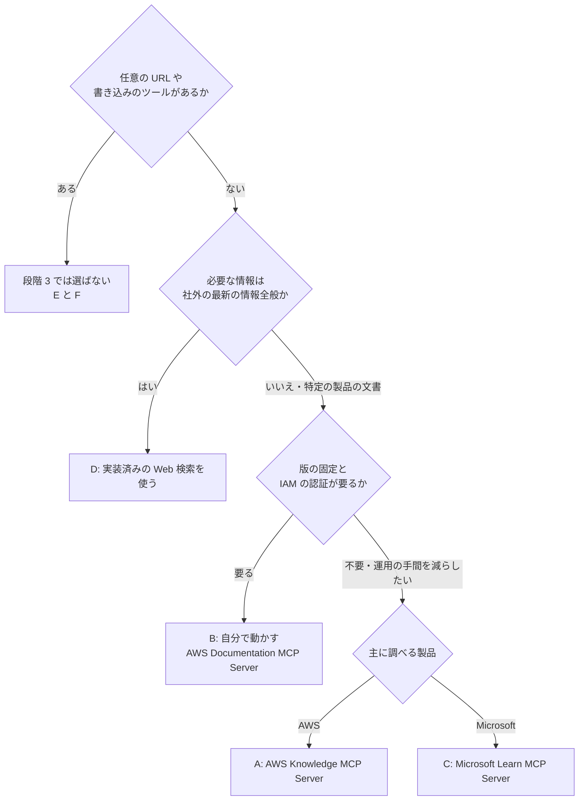

# 社外の MCP サーバーから最初に足すツールの選び方

この文書は、このリポジトリの RAG システム（社内の文書を、利用者が読める範囲だけ検索して回答する Web アプリ）に、社外のツールを足すときの選び方をまとめたものです。[MCP と Flows の脅威モデル](mcp-flows-threat-model.md) は、ツールを 3 段階で足すと決めています。段階 1 は Bedrock Flows の呼び出し（実装済み）、段階 2 は社内のツール、段階 3 は社外の MCP サーバーの読み取りだけのツールを 1 つ足すことで、この文書は段階 3 でどのツールを足すかを決めるための材料です。MCP やエージェントに詳しくない読者も同じ観点で比べられるように、前半に判断の材料（用語、確かめる観点、候補の比較、選び方）を、最後にこのリポジトリの判断を分けて書きます。製品やサービスの優劣を決める文書ではありません。同じ観点で並べ、条件が違えば別の候補が合うことも書きます。

## 結論

- **判断の材料**: 「読み取りだけのツール」でも、検索語や URL といった引数は社外へ出ます。候補は「確かめる観点」の節の 6 つの観点で比べます。特に上の 4 つ（社外へ出るもの、読める先、誰がどこで動かすか、後から中身が変わるか）は、ツールが何をできるかより先に確かめます
- **このリポジトリの判断**: 最初の 1 つは、AWS のドキュメントを検索して読むツール（候補 B）にしました。理由と、受け入れる制約は「このリポジトリの判断」の節にあります

## 用語

| 用語 | 意味 |
|---|---|
| MCP | Model Context Protocol。モデル（生成 AI）が外部のツールやデータを呼ぶための約束事 |
| MCP サーバー | ツール（検索、読み取りなど）を MCP という約束事で公開するプログラム |
| リモートの MCP サーバー | 提供元がインターネット上で動かしているもの。こちらは URL を指定してつなぐだけ |
| 自分で動かす MCP サーバー | プログラムを自分のアカウントの中で動かすもの。版を固定できる代わりに、動かす手間がかかる |
| 引数 | ツールに渡す値。検索ツールなら検索語、読み取りツールなら URL。モデルが会話の内容から作る |
| 版の固定 | 使うプログラムの版を決めて、勝手に新しい版へ変わらないようにすること |
| ツールの定義の固定 | Gateway に、ツールの名前・説明・引数の形をこちらで渡しておくこと（`mcpToolSchema`）。サーバー側で説明が変わっても、モデルが見る説明は変わらない |
| Gateway | Amazon Bedrock AgentCore Gateway。複数のツールを 1 つの窓口にまとめ、どのツールを誰が呼べるかを決める AWS のサービス。この RAG はすでに使っている |
| AgentCore Runtime | プログラム（エージェントや MCP サーバー）を AWS の中で動かすためのサービス。自分の AWS アカウントの中で動く |
| Cedar | Gateway が使う、許可と拒否の規則を書く言語。「この名前のツールだけ呼べる」のように書く |
| IAM（SigV4） | AWS の認証の仕組み。呼び出しに AWS の署名を付け、呼ぶ側の権限を確かめる。パスワードや API キーを置かずに済む |
| SID フィルタ | この RAG の権限の仕組み。検索した社内の文書を、利用者が読めるものだけに絞る |
| 脅威 T4〜T8 | [脅威モデル](mcp-flows-threat-model.md) の番号。T4 は文書やツールの応答に書かれた指示でモデルが別のツールを呼ぶこと、T6 はツールが後から変わること、T7 は API キーが見えてしまうこと、T8 は VPC（AWS の中の閉じたネットワーク）の中の管理用の窓口へ届いてしまうこと |

## 確かめる観点

候補ごとに、次の 6 つを同じ順で確かめます。上ほど情報の漏れに直結します。

| # | 観点 | 確かめること | なぜ要るか |
|---|---|---|---|
| 1 | 社外へ出るもの | ツールの引数（検索語、URL）がどこへ送られるか | モデルは会話の内容から引数を作る。検索した社内の文書に「この内容で検索せよ」と書かれていれば、その内容が検索語として社外へ出うる（脅威 T4） |
| 2 | 読める先 | ツールがどこまで取りに行けるか（特定のサイトだけか、任意の URL か） | 任意の URL を取れるツールは、社外の任意のサーバーへデータを送る道になり、VPC の中の管理用の窓口にも届きうる（T4、T8） |
| 3 | 誰がどこで動かすか | リモートか、自分のアカウントで動かすか。動く場所（リージョン） | データの置き場所の要件（日本の中で処理するか）と、障害や停止のときに誰が直すか |
| 4 | 中身が後から変わるか | 版を固定できるか。ツールの説明や挙動が提供元の都合で変わるか | 承認したときと違うツールが動く（T6）。定義の固定（`mcpToolSchema`）で説明は固定できるが、挙動は固定できない |
| 5 | 認証 | Gateway からどの認証で呼ぶか（認証なし、OAuth、IAM、API キー） | Gateway のドキュメントは「認証なし」を推奨していない（[MCP サーバーのターゲット](https://docs.aws.amazon.com/bedrock-agentcore/latest/devguide/gateway-target-MCPservers.html) の Authorization strategy、2026-11-18 に読んだ）。API キーは置き場所を管理する必要がある（T7） |
| 6 | 書き込みと送信 | 書き込み、送信、削除のツールが混ざっていないか | 段階 3 は読み取りだけに限る。混ざっていれば、読み取りのツールだけを名前で許可する |

> **読み取りだけでも外へ出るものに関する補足**: 観点 1（社外へ出るもの）は、どの候補でもなくなりません。この RAG に足すときは、Web アプリが検索語の長さに上限を設け、Gateway が許可したツールの名前以外を拒否し（Cedar）、呼び出しを記録します。それでも、短い検索語に社内の情報が含まれる可能性は残ります。社内の情報を検索語にしてよいかは、組織の情報の扱いの規程で決めることで、ツールの選択では決まりません

## 候補

段階 3 の条件（社外のサーバーの、読み取りだけのツールを 1 つ）に照らして、6 つを並べます。

| 候補 | 誰がどこで動かすか | 読める先 | 社外へ出るもの | 後から中身が変わるか | 認証 | 書き込み |
|---|---|---|---|---|---|---|
| A. AWS Knowledge MCP Server | AWS がリモートで運営（`https://knowledge-mcp.global.api.aws`） | AWS のドキュメント、What's New、ブログ、リージョンの提供状況など | 検索語と URL が AWS の公開の窓口へ | 運営側で変わる。版は固定できない（ツールの定義は固定できる） | 不要（提供元のページに「利用量の制限がある」と記載）。Gateway からは「認証なし」でつなぐ | なし |
| B. AWS Documentation MCP Server | 自分のアカウントで動かす（オープンソース、Apache-2.0。AgentCore Runtime などに置く） | `docs.aws.amazon.com` の系列だけ（リダイレクト先も確かめる） | 検索語は AWS のドキュメント検索の API へ、URL は docs.aws.amazon.com へ | 版を固定できる | Gateway から IAM（SigV4）で呼べる（AgentCore Runtime に置く場合） | なし |
| C. Microsoft Learn MCP Server | Microsoft がリモートで運営（`https://learn.microsoft.com/api/mcp`） | Microsoft の公開ドキュメントとコードの例 | 検索語と URL が Microsoft の公開の窓口へ | 運営側で変わる。版は固定できない（ツールの定義は固定できる） | 不要（提供元のページに記載）。Gateway からは「認証なし」でつなぐ | なし |
| D. この RAG の Web 検索（AgentCore Gateway の web-search コネクタ） | AWS（us-east-1。このリポジトリに実装済み） | インターネット全体の検索結果 | 検索語が us-east-1 の Gateway と、その先の検索サービスへ（どの事業者かは確かめていない） | 運営側で変わる | Gateway の実行ロール（IAM） | なし |
| E. 汎用の URL 取得（参照実装の fetch など） | 自分で動かす | 任意の URL | 任意の URL と、その URL に埋めた内容 | 版を固定できる | 動かし方次第（自分で選ぶ） | 取得だけだが、URL に情報を埋めれば送信と同じ |
| F. SaaS の MCP サーバー（コードの管理、チケット管理など） | 提供元がリモートで運営 | その SaaS の中の、利用者が見られるもの | 検索語と、SaaS 側の利用者の識別 | 運営側で変わる | 利用者ごとの OAuth が要る | 多くは書き込みのツールも持つ |

候補ごとに、合う場面、考慮が要る点、提供元がデータの扱いについて書いていることを、同じ形で書きます。

- **A**: 合う場面は、運用の手間をかけずに AWS の幅広い情報（新機能の発表、ブログ、リージョンの提供状況）を使いたいとき。考慮が要る点は、Gateway から認証なしでつなぐこと、版を固定できないこと、公開のインターネットへ出る経路が要ること。提供元のページは、AWS Site Terms に従うこと、テレメトリを機械学習のモデルの学習や改善に使わないことを書いている
- **B**: 合う場面は、版を固定し、自分のアカウントとリージョンの中で動かし、IAM で認証したいとき。考慮が要る点は、動かす場所（AgentCore Runtime など）を用意して保守する手間と、その利用料金。読めるのは AWS のドキュメントのページに限られ、A より情報源が狭い。プログラムは自分のアカウントで動くので、データの扱いは自分で決める。検索語を受け取る AWS のドキュメント検索の API のデータの扱いは確かめていない
- **C**: 合う場面は、利用者が Microsoft の製品（Active Directory、Windows のファイル共有など）について調べることが多いとき。考慮が要る点は、A と同じく、認証なしでつなぐこと、版を固定できないこと、公開のインターネットへ出る経路が要ること。提供元のページは、Microsoft Learn の利用規約に従うこと、料金がかからないこと、中身が公開のドキュメントで、利用者のプロフィールの情報を含まないことを書いている。テレメトリの扱いは、そのページには書かれていない
- **D**: 合う場面は、社外の最新の情報を広く引きたいとき。考慮が要る点は、検索結果が信頼できない入力であること（このリポジトリでは「参照」として区別して表示する）、us-east-1 で動くこと。すでに実装済みで、段階 3 で新しく足すものではない
- **E**: 段階 3 では選ばない。任意の URL を取れるので、URL に情報を埋めて社外へ送る道になる。VPC の中で動かした場合は、VPC の中の管理用の窓口にも届きうる。使うなら、取得先を特定のサイトに限る仕組みが別に要る
- **F**: 段階 3 では選ばない。利用者ごとの OAuth と、SaaS 側の権限をこの RAG の権限とどう対応させるかの設計が要り、読み取りと書き込みのツールを分ける作業も要る。必要になったら別の段階として扱う

## 選び方

次の図は一般的な目安です。このリポジトリが実際にどれを選んだかは、次の節に分けて書きます。

## このリポジトリの判断

最初の 1 つは **B（AWS Documentation MCP Server を自分のアカウントで動かす）** にします。許可するツールは `search_documentation`、`read_documentation`、`read_sections` の 3 つで、名前で許可します。

| 観点 | B を選ぶ理由（A・C と比べて） | 受け入れる制約 |
|---|---|---|
| 社外へ出るもの | 出るのは検索語と、docs.aws.amazon.com の URL だけ。A・C も検索語と URL が出る点は同じ | 検索語に社内の情報が混じる可能性は残る。Web アプリで検索語の長さに上限を設ける |
| 読める先 | サーバーのコードが、URL とリダイレクト先を docs.aws.amazon.com の系列に限っている | 確かめたのはコードを読んだことだけで、実機では試していない（下の補足） |
| 誰がどこで動かすか | ap-northeast-1 の AgentCore Runtime に置ける。A・C は提供元の窓口で動く | 動かす場所の用意と保守を自分で行う |
| 後から中身が変わるか | 版を固定でき、更新は差分を読んでから行える。A・C は版を固定できない | 更新を自分で追う必要がある |
| 認証 | Gateway から IAM（SigV4）で呼べる。A・C は「認証なし」でつなぐ | なし |
| 書き込み | ない（A・C も同じ） | なし |
| 情報源 | AWS のドキュメントのページ | A より狭い（What's New、ブログ、リージョンの提供状況は引けない） |
| 料金 | 自分のアカウントの AgentCore Runtime の利用料金がかかる。A・C は提供元のページで料金がかからないとされる | 単価は確かめておらず、実装の前に料金のページで確かめる |

> **確かめた範囲に関する補足**: awslabs/mcp の `server_aws.py` の `_require_supported_domain` と、`server_utils.py` のリダイレクトの検査を、2026-11-18 に main ブランチで読んだ（そのときの `pyproject.toml` の版は 1.2.6）。リリース済みのパッケージが同じ内容かと、実機での動きは確かめていない。実装のときに、版を固定したパッケージで docs.aws.amazon.com 以外の URL が拒否されることを確かめる

**この判断が変わる条件**: 運用の手間を最小にしたい、または What's New やブログまで引きたい場合は A が合います。そのときは、認証なしでつなぐことと版を固定できないことを、組織として受け入れるかを先に決めます。利用者が主に Microsoft の製品について調べる場合は C が合い、考慮点は A と同じです。

## よくある質問

**Q. 「読み取りだけ」なら安全ではないのですか。**
A. ツールが書き込まなくても、引数（検索語や URL）は社外へ送られます。どの候補でも残る点で、検索語の長さの上限、許可するツールの限定、呼び出しの記録で小さくします。

**Q. リモートの MCP サーバーと、自分で動かす MCP サーバーの違いは何ですか。**
A. リモートは提供元が動かすので手間は少ない一方、版を固定できず、中身は提供元の都合で変わります。自分で動かすと版を固定でき、自分のアカウントの認証（IAM）で守れますが、動かす場所と保守が要ります。

**Q. 社内の文書を読むツールは、この選択に含まれますか。**
A. 含まれません。社内の文書は、利用者ごとに読める範囲が違うため、読めるかどうかを確かめる仕組み（SID フィルタ）を通す必要があります。そのため、社外のツールとは分けて、社内のツール（脅威モデルの段階 2）として扱います。

## 関連ドキュメント

- [MCP と Flows の脅威モデル](mcp-flows-threat-model.md)
- [実装の概要](implementation-overview.md)（Agent モード、AgentCore Policy、Web 検索）
- [AWS Knowledge MCP Server](https://awslabs.github.io/mcp/servers/aws-knowledge-mcp-server)、[AWS Documentation MCP Server](https://awslabs.github.io/mcp/servers/aws-documentation-mcp-server)、[Microsoft Learn MCP Server](https://learn.microsoft.com/en-us/training/support/mcp)
- [AgentCore Gateway の MCP サーバーのターゲット](https://docs.aws.amazon.com/bedrock-agentcore/latest/devguide/gateway-target-MCPservers.html)（認証の種類、ツールの定義の固定）
