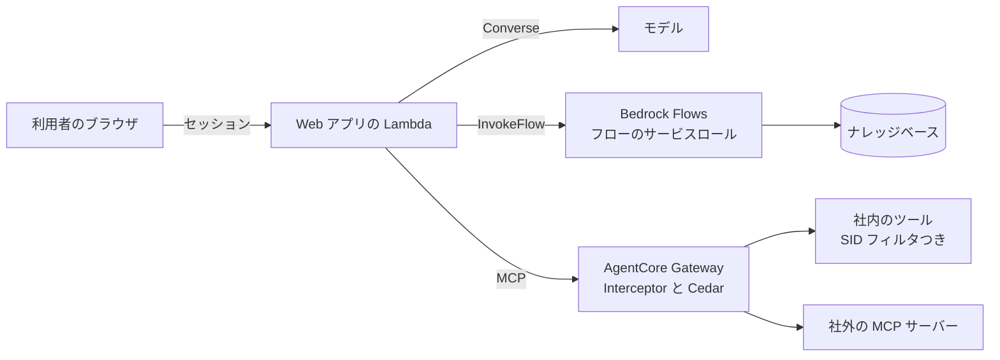

# MCP のツールと Bedrock Flows を足す前の脅威モデル

GenU の「MCP チャット」と「Flow チャット」に相当する機能を、この権限つき RAG に足すときの脅威と、その対策としての設計の判断をまとめます。実装の前に置く文書で、ここで決めた制約を満たす形だけを実装します。

## 結論

- **Bedrock Flows のナレッジベースノードは、呼んだ利用者の権限で絞り込めません。** フローはフロー自身のサービスロールで動き、ノードの設定にも利用者ごとのフィルタの項目がありません。ナレッジベースノードを含むフローを利用者に開くと、その KB の文書が、読めない利用者にも渡ります。このため、フローは管理者が登録したものだけを呼び、呼ぶたびにフローの定義を読んで、社内のデータを読むノードや外へ書くノードを含むものを拒否します
- **MCP のツールは、Web アプリの Lambda の中では動かしません。** GenU も、Lambda の中で `uvx` / `npx` の MCP サーバーを動かす MCP チャットを非推奨にし、AgentCore を使う形へ移しています。この RAG の Agent モードはすでに AgentCore Gateway と権限の Interceptor を通るので、MCP のツールはこの Gateway のターゲットとして足し、ツールごとの許可（Cedar）と利用者の識別をそこで行います
- **社内の文書を読むツールは、KB モードと同じ SID フィルタを通したものだけにします。** 権限の境界を SID フィルタの 1 か所に保ち、ツールやフローに別の境界を作りません

## 用語

| 用語 | この文書での意味 |
|---|---|
| MCP | Model Context Protocol。モデルが外部のツールやデータを呼ぶための約束事 |
| MCP サーバー | ツールを MCP で公開するプログラム。社外の製品やオープンソースが多い |
| AgentCore Gateway | 複数のツールを 1 つの MCP の窓口にまとめる AWS のサービス。この RAG の Agent モードが使っている |
| Bedrock Flows | プロンプト、ナレッジベース、Lambda などのノードをつないだ処理の流れを定義して呼ぶ Bedrock の機能 |
| SID フィルタ | 検索した文書を、利用者の SID と文書のメタデータの SID で照合して絞る、この RAG の権限の境界（`sid-filter.ts`） |

## 守るものと信頼の境界

守るものは、SID で読める人が決まっている社内の文書、利用者の識別（誰の権限で動くか）、Web アプリのロールの権限、利用料金の 4 つです。

境界は 3 つあります。利用者から Web アプリ（セッションで本人を確かめる）、Web アプリからフロー（フローは利用者ではなくフローのロールで動く）、Web アプリから Gateway の先のツール（ツールは利用者ではなくツールの実行ロールで動く）です。後ろの 2 つでは、利用者の権限が自動では引き継がれません。

## 脅威

| # | 脅威 | 起きる場所 | 起きたときの影響 |
|---|---|---|---|
| T1 | フローのナレッジベースノードが、利用者の SID で絞らずに文書を返す | Flows | 読めない文書が回答に入る（権限の境界を素通りする） |
| T2 | フローのエージェントノード、S3 取得ノード、Lambda ノードが、フローのロールで社内のデータを読む | Flows | T1 と同じ |
| T3 | フローの S3 保存ノードや Lambda ノードが、利用者の入力や回答を外へ書く | Flows | 利用者が意図しない場所にデータが残る |
| T4 | 検索した文書やツールの応答に書かれた指示で、モデルが別のツールを呼ぶ（間接的なプロンプトインジェクション） | MCP | 利用者が読める文書の中身を、社外のツールへ送られる |
| T5 | ツールが Web アプリのロールで動き、利用者が持たない権限で読む（混乱した代理人） | MCP | 読めない文書や他人のデータが返る |
| T6 | 社外の MCP サーバーが、ツールの説明や挙動を後から変える。`npx` / `uvx` は起動のたびに最新の版を取りに行く | MCP | 承認したときと違うツールが動く（供給網の問題） |
| T7 | MCP サーバーの API キーを Lambda の環境変数に置く | MCP | Lambda の設定を読める人にキーが見える |
| T8 | VPC の中で動くツールが、VPC の中の管理用の窓口（FSx for ONTAP の管理 IP など）へ届く | MCP | 社内の管理面が外部のツールから叩かれる |
| T9 | ツールの呼び出しが止まらずに続く | MCP / Flows | 料金と時間が増える |
| T10 | 誰がどのツール・フローを、どんな入力で呼んだかが残らない | 両方 | 事故の後に追えない |

> **フローのナレッジベースノードに関する補足**: ノードの設定にあるのは `knowledgeBaseId`、`modelId`、`guardrailConfiguration` で（[Flows のノードの種類](https://docs.aws.amazon.com/bedrock/latest/userguide/flows-nodes.html)）、SDK（`@aws-sdk/client-bedrock-agent` 3.1164.0）の `KnowledgeBaseFlowNodeConfiguration` に足されているのも件数、プロンプトのテンプレート、推論の設定、並べ替え、オーケストレーションの設定で、検索のフィルタの項目はありません。フローのサービスロールには、ノードが問い合わせる KB への権限が要ります（[Flows のサービスロール](https://docs.aws.amazon.com/bedrock/latest/userguide/flows-permissions.html)）。この 2 つから、呼んだ利用者で絞る手段はないと判断しています（documented。実機での確認はしていません）

> **GenU の MCP チャットに関する補足**: GenU のデプロイのオプションの文書は、MCP チャットを非推奨とし、MCP には AgentCore のユースケースを使うよう案内しています。MCP サーバーは Lambda の中で `uvx` か `npx` で動き、stdio だけ、API キーは `mcp.json` の `env` に書く、という制約が挙がっています（[GenU の DEPLOY_OPTION](https://github.com/aws-samples/generative-ai-use-cases/blob/main/docs/en/DEPLOY_OPTION.md)）

## 設計の判断

### Flows

| 判断 | 対策する脅威 |
|---|---|
| 呼べるのは、管理者が CDK のコンテキストで登録したフロー（`flowId` と `aliasId`）だけ | T1〜T3 |
| 呼ぶたびに、エイリアスが指すフローの版の定義を読み、許可したノードの種類（入力、出力、プロンプト、条件、反復、集約、繰り返し）だけでできているかを確かめる。それ以外（ナレッジベース、エージェント、S3 取得、S3 保存、Lambda、インラインコード、Lex）を含むフローは呼ばずに拒否する | T1〜T3 |
| 版はエイリアスから毎回読み直す。エイリアスの向き先が変わっても、検査を通らない版は呼ばない | T1〜T3、T6 |
| 社内の文書を使いたい処理は、フローではなく KB モード（SID フィルタ）を使う | T1、T2 |
| 利用者、フロー、版、許可と拒否の結果を構造化ログに残す。入力の本文は残さない | T10 |

> **検査と呼び出しの間の差に関する補足**: `InvokeFlow` はエイリアスを指定して呼び、版を指定できません。検査のあと呼び出しまでの間にエイリアスの向き先が変わると、検査していない版が動きます。間は API の呼び出し 2 回分で、エイリアスを変えられるのは Bedrock の管理権限を持つ人だけです。この差は残るリスクとして扱い、エイリアスの変更権限を管理者に限ることで抑えます

> **インラインコードノードに関する補足**: インラインコードノードの実行環境から何に届くか（ネットワーク、AWS の API）は確かめていません（hypothesis）。届かないことを確かめるまでは、許可するノードに入れません

### MCP

| 判断 | 対策する脅威 |
|---|---|
| MCP サーバーは Web アプリの Lambda の中で動かさず、Agent モードの AgentCore Gateway のターゲットとして足す | T5、T7、T8 |
| ツールは名前で許可する一覧（Cedar の `permit`）に載ったものだけを呼べる。MCP サーバーが付ける「読み取り専用」の注記は、サーバー自身の申告なので判断の根拠にしない | T4、T6 |
| 社外へデータを送れるツール（書き込み、送信、任意の URL の取得）は既定で許可しない | T4 |
| 社内の文書を読むツールは、既存の `permission-search` と同じく SID フィルタを通す。利用者は、Agent モードと同じく Web アプリがセッションから決めて渡し、モデルが引数で指定することはできない | T5 |
| 社外の MCP サーバーの認証情報は Secrets Manager か AgentCore Identity に置き、Lambda の環境変数には置かない | T7 |
| ツールの呼び出しは 1 回の質問につき回数の上限を設ける | T9 |
| Gateway のポリシーは `LOG_ONLY` で動きを確かめてから `ENFORCE` にする（AGENTS.md の Cedar の注意と同じ） | T4、T6 |

## 段階的な導入

1. **Flows**: 許可したノードだけのフローを呼ぶ API と画面。拒否の判定を単体テストで、許可と拒否を実機で確かめる（実装済み。確認結果は [評価](evaluation.md) 3.17）
2. **MCP（社内のツール）**: すでにある `permission-search` 以外の社内のツールを Gateway に足す場合も、この文書の判断に従う
3. **MCP（社外のサーバー）**: 読み取りだけのツールを 1 つ、名前で許可して足す（実装済み: `-c enableAwsDocsTool=true`、[実装の概要](implementation-overview.md) 8 節）。社外へ送るツールは、この段階では足さない。足すツールの選び方と判断は [社外の MCP サーバーから最初に足すツールの選び方](mcp-external-tool-selection.md)

## よくある質問

**Q. フローのナレッジベースノードにメタデータのフィルタを書けば、利用者で絞れますか。**
A. ノードの設定に検索のフィルタの項目がなく、あっても値はフローの定義に固定されるので、呼んだ利用者ごとに変えられません。社内の文書は KB モードで扱ってください。

**Q. MCP サーバーが「読み取り専用」と申告していれば、許可してよいですか。**
A. 申告はサーバー自身が書くもので、後から変わることもあります。許可はツールの名前で、管理者が内容を確かめたうえで行います。

**Q. Agent モードと MCP チャットは別の機能ですか。**
A. この RAG では分けません。Agent モードが AgentCore Gateway を通じてツールを呼ぶ仕組みが、MCP のツールを呼ぶ仕組みそのものです。

## 次の手順

この文書の判断に沿って、Flows の呼び出し（段階 1）から実装します。MCP の社外のサーバー（段階 3）は、足すツールが決まってから始めます。

## 関連ドキュメント

- [実装の概要](implementation-overview.md)（SID フィルタ、Agent モード、AgentCore Policy）
- [第 2 段の設計](genu-stage2-design.md)
- [社外の MCP サーバーから最初に足すツールの選び方](mcp-external-tool-selection.md)
- [認証・ユーザー管理ガイド](auth-and-user-management.md)（管理者ロール）
