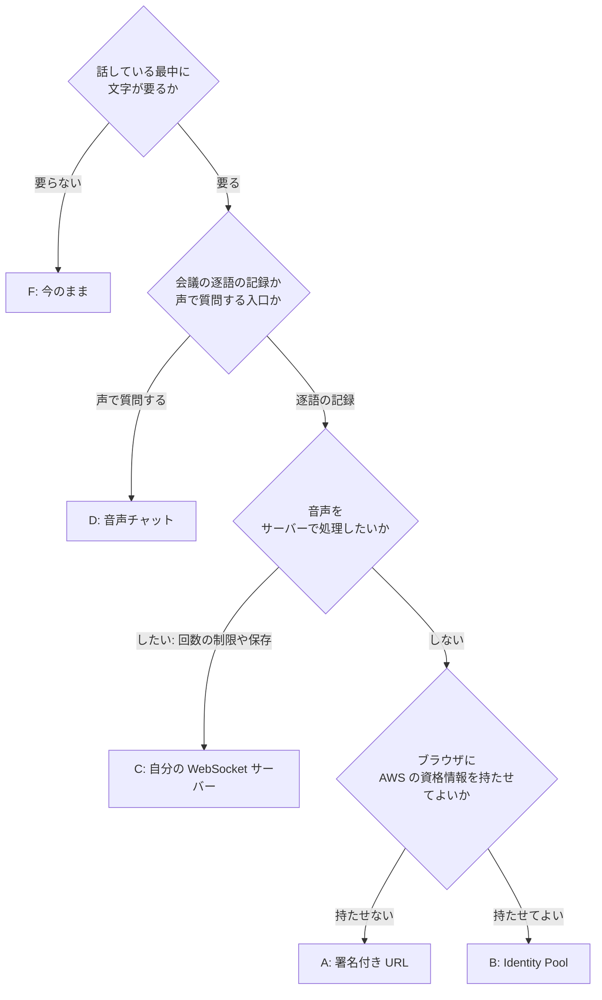

# リアルタイムの文字起こしの選択肢
**🌐 Language:** **日本語** | [English](en/realtime-transcription-options.md)

この文書は、このリポジトリの RAG アプリ（社内の文書を、利用者が読める範囲だけ検索して回答する Web アプリ）に、話している最中の音声を文字にする機能を足すときの選択肢をまとめたものです。**実装はしていません。** 今ある議事録は、録音ファイルを S3 に置いて Amazon Transcribe のバッチのジョブで文字起こしする方式（[第 2 段の設計](genu-stage2-design.md)）で、話している最中の文字起こしはありません。選択肢を並べ、判断に必要な事実を揃えるところまでを書きます。このリポジトリとしてどれを選ぶかは決めていません。

## 結論
- 日本語の文字起こしを AWS の中で行う選択肢は、Amazon Transcribe のストリーミング（A・B・C）と、Amazon Nova Sonic（D）です。Nova Sonic は会話の相手として使う音声のモデルで、すでに音声チャットで使っています（議事録のような逐語の記録を目的にしていません）
- A・B・C の違いは、ブラウザが Transcribe にどう認証して届くかと、途中に自分の計算資源を置くかどうかです。Transcribe に渡す音声と得られる文字は同じです
- 音声チャットのコードのコメントは、Web アプリの Next.js のルート（Lambda 上）が WebSocket のアップグレードを受けられないと書いています（今回は確かめ直していません）。このため、サーバーが音声を受ける C だけが、WebSocket を受ける計算資源を新しく要します
- どの選択肢でも、文字起こしの結果は RAG の検索対象の文書ではなく、利用者本人の入力です。SID フィルタ（読める文書だけに絞る仕組み）の対象は、文字を作った後に検索へ回す段で効きます

## 用語
| 用語 | 意味 |
|---|---|
| ストリーミング | 音声を細かく区切って送り続け、文字を返し続ける方式。これに対して今の議事録はバッチ（録音全体を置いてから 1 回で処理） |
| 署名付き URL | AWS の署名を URL に埋め込み、一定時間だけ接続を許す URL。Transcribe の WebSocket は、署名付き URL で接続を始める |
| Cognito Identity Pool | ログイン済みの利用者に、ブラウザで使える短時間の AWS の資格情報を渡す仕組み。User Pool（ログイン）とは別のリソース |
| 話者の分離 | 話者ごとにラベルを付けること。ストリーミングでも使える |
| Nova Sonic | 音声を入力して音声と文字を返す Amazon のモデル。双方向のストリームで使う |

## 確かめる観点
候補ごとに、次の 5 つを同じ順で確かめます。
1. 音声と文字がどこへ行くか
2. ブラウザが何で認証するか
3. 途中に何を動かすか
4. 長さと同時接続の上限
5. 料金

## 選択肢
| 記号 | 方式 | 音声の行き先 | ブラウザの認証 | 途中で動かすもの |
|---|---|---|---|---|
| A | ブラウザから Transcribe へ WebSocket で直接。URL は Web アプリが署名する | 自分のアカウントの Transcribe（東京） | Web アプリが作る署名付き URL（接続開始の 5 分以内だけ有効） | なし（署名を作る API を 1 本足す） |
| B | ブラウザから Transcribe へ直接。ブラウザが Identity Pool の資格情報で署名する | 同上 | Identity Pool の短時間の資格情報 | Identity Pool と IAM ロールを足す |
| C | ブラウザ → 自分の WebSocket サーバー → Transcribe（HTTP/2） | 同上（サーバーを経由する） | WebSocket サーバーへの接続の認証（SigV4 か OAuth など） | WebSocket を受ける計算資源（AgentCore Runtime、API Gateway の WebSocket など） |
| D | Nova Sonic の双方向ストリーム（今の音声チャットの仕組み） | 同じアカウントの Bedrock（東京） | 今の Web アプリの認証 | 追加なし（音声チャットは実装済み） |
| E | ブラウザ内蔵の音声認識（Web Speech API） | ブラウザの提供元の仕様による | なし | なし |
| F | 今のまま（録音ファイルをバッチで処理） | 自分のアカウントの Transcribe と S3 | 今の Web アプリの認証 | なし |

### 共通の事実（Transcribe のストリーミング、A・B・C）
- **[documented]** 東京（ap-northeast-1）にストリーミングのエンドポイントがある（[エンドポイントとクォータ](https://docs.aws.amazon.com/general/latest/gr/transcribe.html)）
- **[documented]** 日本語はストリーミングに対応した言語として発表されている（[発表](https://aws.amazon.com/blogs/machine-learning/amazon-transcribe-streaming-adds-support-for-japanese-korean-and-brazilian-portuguese/)）。現在の言語表の `ja-JP` の行は確かめていない
- **[documented]** 話者の分離はストリーミングでも使え、2〜5 人で最も合う。5 人を超えると精度が下がる（[ブログ](https://aws.amazon.com/blogs/machine-learning/using-speaker-diarization-for-streaming-transcription-with-amazon-transcribe-and-amazon-transcribe-medical/)）
- **[documented]** 音声の形式は PCM（符号付き 16 ビット、リトルエンディアン。WAV は含まない）、FLAC、Ogg の OPUS。16,000 Hz を勧めている。1 つのストリームに 1 回の接続（[ストリーミング](https://docs.aws.amazon.com/transcribe/latest/dg/streaming.html)）
- **[documented]** 同時のストリームは既定で 25（引き上げ可）。1 回の接続は最長 8 時間（[クォータ](https://docs.aws.amazon.com/general/latest/gr/transcribe.html)、[FAQ](https://aws.amazon.com/transcribe/faqs/)）
- **[documented]** 料金は、ap-northeast-1 の標準のストリーミングが 1 秒あたり 0.0001667 USD（1 分 0.01 USD、1 時間 0.60 USD）。AWS Price List API で 2026-11-19 に取得
- **[documented]** Transcribe が処理した音声は、サービスの提供と改善に使われることがある。AWS Organizations のオプトアウトのポリシーで止められる（[FAQ](https://aws.amazon.com/transcribe/faqs/)）。社内の会議を扱うなら、組織としてポリシーを決めてから使う

### A: Web アプリが署名する URL でブラウザが直接つなぐ
- **[documented]** WebSocket の署名付き URL は、`X-Amz-Expires` の最大が 300 秒（5 分）。これは接続を始めるまでの有効期間で、つないだ後の長さの上限は上の 8 時間（[WebSocket のストリーム](https://docs.aws.amazon.com/transcribe/latest/dg/streaming-setting-up.html)）
- 署名には Web アプリの Lambda のロールを使うので、そのロールに `transcribe:StartStreamTranscriptionWebSocket` を足す。**URL を取得できる利用者は、だれでも Transcribe を使える**ので、署名を作る API は、ログイン済みで、回数を制限し、使う言語と形式を固定する
- 新しいリソースは作らない。署名の API 1 本と、ブラウザで音声を PCM に変える処理（マイクの入力、16 kHz への変換、100〜200 ms ごとの送信）が実装の中心

### B: Identity Pool の資格情報でブラウザが署名する
- ブラウザで SDK がそのまま使えるが、Identity Pool と、ログイン済みの利用者が引き受ける IAM ロールが増える。資格情報が有効な間は、そのロールで許したことをブラウザが直接できる。ロールの許可は `transcribe:StartStreamTranscriptionWebSocket` に限る
- このリポジトリには Identity Pool がない（`lib/` に `IdentityPool` を含む記述が無いことを確認）。足すと、利用者の認証の仕組みが 1 つ増える

### C: 自分の WebSocket サーバーが音声を受ける
- 音声がサーバーを通るので、文字を作る前後に処理を置ける（利用者ごとの回数の制限、文字の保存、話者の名前づけ）。サーバーは Transcribe に HTTP/2 で送る
- **[documented]** AgentCore Runtime は WebSocket の `/ws` を受けられ、SigV4 の署名付き URL か OAuth 2.0 で接続できる（[WebSocket の開始](https://docs.aws.amazon.com/bedrock-agentcore/latest/devguide/runtime-get-started-websocket.html)）。このリポジトリの Agent は、すでに AgentCore Runtime で動いている
- 計算資源の運用と、接続を受ける認証の設計が増える。A より足すものが多い

### D: Nova Sonic
- 東京に `amazon.nova-2-sonic-v1:0` と `amazon.nova-2-5-sonic` がある（2026-11-19、`aws bedrock list-foundation-models`）。**日本語の対応は今回確かめていない**
- 用途は、話しかけて答えをもらう会話です。会議の逐語の記録や、話者の分離は目的にしていない。今の音声チャットの接続の上限は、リポジトリの文書では 8 分（今回は確かめ直していない）
- 文字起こしだけが目的なら、選ぶ理由は少ない。会議の記録ではなく「声で質問する」入口を作るなら、すでにある

### E: ブラウザ内蔵の音声認識
- AWS の外の機能で、音声がどこで処理されるかはブラウザの提供元と利用者の環境による。確かめていない。社内の情報を話す場面では、行き先を確かめられない点が最大の考慮点
- 対応するブラウザと日本語の精度も環境によって変わる

### F: 今のまま
- 録音を終えてから処理するので、話している最中の文字は出ない。足すものは何もなく、すでに ap-northeast-1 で確認済み（[評価](evaluation.md) 3.9）

## 選び方

E は AWS の外で処理されるため、図には入れていません。

## 判断の前に決めること
- 会議の音声を Transcribe がサービスの改善に使うことを、組織として認めるか（オプトアウトのポリシーの要否）
- 同時に使う人数。既定の 25 を超えるなら、Service Quotas で引き上げる
- 文字起こしの結果を保存するか。保存するなら、保存先の権限（本人だけ、または会議の参加者）と保存期間
- 話者の名前づけが要るか（Transcribe の分離は「話者 0、話者 1」のラベルまでで、名前は付かない）

## よくある質問
**Q. 今の議事録の仕組みを置き換えますか。**
A. 置き換えません。リアルタイムは、録音を待たずに文字を見たい場合の追加です。会議の終わりに、得た文字を今の議事録の整形（Bedrock）へ渡せます。

**Q. 日本語の精度は十分ですか。**
A. このリポジトリでは、ストリーミングの日本語を測っていません。バッチの `ja-JP` は 1 文をほぼ逐語で文字にできたことを確かめています（[第 2 段の設計](genu-stage2-design.md)）。実装の前に、実際の会議の音声で測ります。

**Q. 遅延はどれくらいですか。**
A. 測っていません。公式の資料は、音声を 50〜200 ms ごとに区切って送ると遅延が小さくなると書いています（[ストリーミング](https://docs.aws.amazon.com/transcribe/latest/dg/streaming.html)）。

## 関連ドキュメント
- [第 2 段の設計](genu-stage2-design.md)（議事録）
- [実装の概要](implementation-overview.md)
- [Amazon Transcribe のストリーミング](https://docs.aws.amazon.com/transcribe/latest/dg/streaming.html)
- [AgentCore Runtime の WebSocket](https://docs.aws.amazon.com/bedrock-agentcore/latest/devguide/runtime-get-started-websocket.html)
